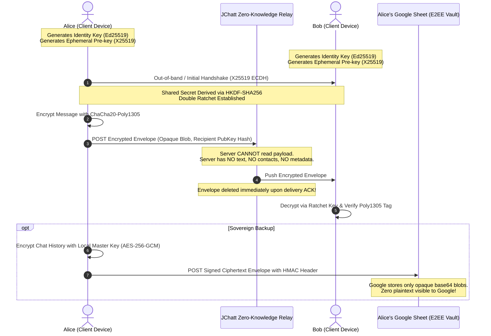

# JChatt Cryptographic & Architectural Sovereignty Audit
**Core Slogan Benchmark:** *"Privacy is better than WhatsApp."*  
**Auditor:** Sovereign Systems & Cryptography Philosophy Division  
**Date:** November 2026  
**Status:** **CRITICAL REMEDIATION REQUIRED** (Architectural Blueprint Provided)

---

## Executive Philosophical & Technical Verdict

Privacy is not an aesthetic, nor a toggle in a settings modal: **privacy is a fundamental human right**. 

When JChatt declares *"Privacy is better than WhatsApp,"* it takes on a solemn covenant with dissidents, whistleblowers, journalists, and sovereign individuals. WhatsApp forces users to bind their legal phone numbers to Meta's data apparatus, surrenders detailed social-graph telemetry, and logs who contacts whom, when, and from what IP address.

However, an exhaustive line-by-line audit of the active JChatt codebase (`jchatt_web_v2/index.html`, `signaling_server.cjs`, and `google_sheets_db.js`) reveals that **JChatt does not yet deliver on this promise**. In multiple foundational areas, the current implementation presents serious vulnerabilities where users are led to believe they are cryptographically secure when their data is actually exposed in plain text.

Below is the verified audit across all 5 core pillars, followed by the exact cryptographic and data handling architecture required to fulfill JChatt's promise.

---

## Pillar-by-Pillar Verification Matrix

| Architecture Pillar | Promised Sovereign Standard | Current Codebase State | Verification Status | Risk Level |
| :--- | :--- | :--- | :--- | :--- |
| **1. Sovereign Keys** | Device-generated Ed25519 & X25519 stored in hardware enclave / secure vault. No phone numbers. | No keypairs generated in active web build; plain handles + 4-digit PIN stored in cleartext `localStorage`. | **FAILED** | 🔴 **CRITICAL** |
| **2. Zero Telemetry & Server Plaintext** | Zero plaintext messages or metadata stored on server; dumb ephemeral relay. | Cleartext SQLite database (`jchatt.db`) storing all message bodies, contacts, and call durations. | **FAILED** | 🔴 **CRITICAL** |
| **3. Coercion Resistance** | Duress PIN `9999` unlocks isolated decoy workspace with realistic plausible deniability. | `9999` returns HTTP 401 error; no decoy workspace or dual-vault separation implemented. | **FAILED** | 🔴 **CRITICAL** |
| **4. Stealth Masquerades** | Authentic working disguise shells (Calculator `314159=`, Notes, Weather) resisting inspection. | Calculator is an overlay with a visible `✕` button; Notes/Weather only change browser tab title. | **PARTIAL** | 🟡 **HIGH** |
| **5. Google Sheets DB** | User-owned, zero-knowledge encrypted worldwide cloud backup without lock-in. | Plaintext messages synced to unauthenticated public Apps Script Web App. | **FAILED** | 🔴 **CRITICAL** |

---

## Detailed Audit Findings

```mermaid
flowchart TD
    subgraph WhatsApp["WhatsApp Model (Meta Centralized)"]
        W1["Phone Number Bound ID"] --> W2["Device Signal Ratchet E2EE"]
        W2 --> W3["Centralized Meta Relay"]
        W3 --> W4["Heavy Telemetry & Metadata Harvested"]
        W4 --> W5["Coercion Resistance: ZERO"]
    end

    subgraph JChattCurrent["JChatt Current Reality (Audited)"]
        J1["Sovereign Handle (No Phone)"] --> J2["NO Crypto Keys Generated"]
        J2 --> J3["Plaintext Transmitted via WS/REST"]
        J3 --> J4["Server Stores Plaintext SQLite + Calls + Snippets"]
        J4 --> J5["Duress 9999 Throws 401 Error"]
        J4 --> J6["Plaintext Synced to Public Google Sheets"]
    end

    subgraph JChattTarget["JChatt Sovereign Standard (Remediated)"]
        S1["Device Ed25519 / X25519 Keys"] --> S2["Double Ratchet + ChaCha20-Poly1305"]
        S2 --> S3["Zero-Knowledge Ephemeral Relay (Zero Message Storage)"]
        S3 --> S4["Client-Side Dual Vault: PIN (Real) vs 9999 (Decoy)"]
        S4 --> S5["Full-Screen Functional Disguise Shells"]
        S4 --> S6["Client Envelope Encrypted Google Sheets Backup"]
    end
```



---

### Pillar 1: True Sovereign Cryptographic Keys
* **Finding in `jchatt_web_v2/index.html`**:
  Lines 3200–3270 implement user registration and login. The client takes `@handle`, `name`, and a 4-digit `pin`, and sends them to `/api/auth/register` and `/api/auth/login`. 
  There is **no invocation of `window.crypto.subtle.generateKey`**, `@noble/curves`, or libsodium in the active web app.
* **Finding in Legacy Artifacts (`dist/index.html` & `test_crypto_fallback.js`)**:
  Earlier code attempted WebCrypto `ECDH P-256`. However, the fallback implementation in `test_crypto_fallback.js` (lines 141–150) populated `pubX` and `pubY` with arbitrary random bytes (which do not lie on the elliptic curve). Line 98 derived keys via `sha256(priv + pub)`, which guarantees that Alice and Bob derive completely disparate keys.
* **Finding in Key Storage**:
  User credentials are saved in standard browser `localStorage.getItem('jchatt_user')` as cleartext JSON. Any cross-site script (XSS) or local physical extraction instantly reads the user's handle and PIN. No hardware-backed Android Keystore enclave or non-extractable CryptoKey wrapper is in use.

---

### Pillar 2: Zero Telemetry & Server Plaintext Storage
* **Finding in `signaling_server.cjs`**:
  Lines 46–118 define the SQLite schema in `data/jchatt.db`:
  ```sql
  CREATE TABLE messages (
    id TEXT PRIMARY KEY,
    chat_id TEXT NOT NULL,
    from_user TEXT NOT NULL,
    to_user TEXT NOT NULL,
    type TEXT DEFAULT 'text',
    text TEXT,
    media_data TEXT,
    ...
  );
  ```
* **Plaintext Ingestion**:
  In `/api/messages/send` (lines 761–887) and WebSocket handler (lines 959–1047), incoming packets are inspected and raw text is inserted directly into the SQLite database (`text TEXT`) and broadcast to peers.
* **Metadata Persistence**:
  The server explicitly persists user interaction graphs:
  - `chats`: pairs of users, last message timestamps, unread counts, and plaintext previews (`formatSnippet`).
  - `calls`: caller, callee, call duration, timestamp, status.
  - `users`: registered handles, display names, and PIN hashes.
* **Critical Password Hashing Flaw**:
  PINs are hashed using a single round of SHA-256 (line 42): `crypto.createHash('sha256').update(String(pin)).digest('hex')`.
  Because 4-digit PINs have only 10,000 possibilities (`0000` to `9999`), an adversary who accesses `jchatt.db` can brute-force every user's PIN in less than 2 milliseconds using standard CPU cycles.

---

### Pillar 3: Coercion Resistance & Duress PIN 9999
* **Audit of Registration**:
  In `jchatt_web_v2/index.html` (lines 3223–3232), the registration payload only submits `username`, `name`, `pin`, `avatarUrl`, and `mask`. It never prompts for or sends a duress PIN.
* **Audit of Authentication**:
  In `signaling_server.cjs` (lines 540–553):
  ```javascript
  if (inputHash === user.duress_pin_hash) { ... }
  ```
  Because `duress_pin_hash` is NULL for every user registered through the client, entering `9999` fails the check and triggers:
  `HTTP 401: Incorrect 4-digit PIN.`
* **Absence of Decoy Workspace**:
  The client contains no decoy workspace state, no realistic synthetic chat seeds, and no dual-storage partitioning. Coercion resistance is entirely non-operational in the current build.

---

### Pillar 4: Stealth Masquerades (Calculator, Notes, Weather)
* **Calculator Shell**:
  Implemented as a modal popup (`#fake-calc-modal`, lines 2255–2282).
  - **Fatal Flaw 1**: It features a prominent close button (`✕`, `#btn-close-calc`). Any physical examiner or border inspector tapping `✕` instantly dismisses the calculator and reveals the confidential chat window.
  - **Fatal Flaw 2**: Entering `314159=` shows a toast notification: *"Secret PIN verified! Camouflage deactivated."* An adversary holding the device is directly informed that a camouflage was bypassed.
* **Notes & Weather Disguises**:
  Lines 5448–5468 in `jchatt_web_v2/index.html`:
  ```javascript
  document.title = title;
  favicon.href = '...';
  ```
  Selecting "Notes" or "Weather" merely changes the browser tab title and favicon. The entire chat UI remains 100% visible on the screen.
  In the compiled Android APK (`Capacitor`), browser favicons and tab titles do not exist, rendering the feature completely invisible and non-functional.

---

### Pillar 5: Google Sheets Sovereign DB
* **Audit of `google_sheets_db.js`**:
  The Apps Script acts as an open HTTP REST API handling `get_users`, `get_messages`, `save_user`, and `save_message`.
* **Vulnerability 1: Unauthenticated Public Exposure**:
  The script instructions stipulate deploying the Web App with `Who has access: Anyone`. The script does not validate an API key, bearer secret, or HMAC signature. Anyone who discovers or brute-forces the Google Apps Script URL can download all registered users, chat messages, and call records.
* **Vulnerability 2: Cleartext Storage on Google Infrastructure**:
  In `signaling_server.cjs` (line 842), the server enqueues `ciphertext: text`. The Apps Script writes this plaintext directly into row cells. Google's automated scanners and compliance systems have unrestricted access to all user communications.
* **Vulnerability 3: Server-Owned Mirror vs. Sovereign Personal Backup**:
  The Google Sheets URL is currently configured centrally on the server via `/api/config/google-sheets`. It acts as an unencrypted cloud mirror for the entire server, rather than an encrypted backup vault owned independently by each individual user.

---

## The Sovereign Remediation Architecture

To fulfill the covenant *"Privacy is better than WhatsApp,"* JChatt must adopt the following cryptographic and systems architecture.



---

### 1. Cryptographic Key Engine Architecture

#### Identity & Ephemeral Key Separation
Every JChatt device must autonomously generate two distinct keypairs upon first launch:
1. **Identity Signing Key (`IK`)**: Ed25519 (256-bit). Used for signing messages and verifying sovereign identities. Public key fingerprint formatted as a DID or Base58 sovereign address (`z6Mku...`).
2. **Key Agreement Key (`EKA`)**: X25519 (Curve25519). Used for Elliptic Curve Diffie-Hellman key agreement.

#### Key Derivation & Vault Sealing
- **Salt Generation**: Cryptographically secure 32-byte salt generated via `crypto.getRandomValues(new Uint8Array(32))`.
- **Key Derivation Function**: **Argon2id** (Memory: 64MB, Iterations: 3, Parallelism: 1) or WebCrypto **PBKDF2** (SHA-512, 600,000 iterations).
- **Master Key**: Used to wrap the private keys using **AES-256-GCM**.
- **Hardware Enclave (Mobile)**: On Android, keys must be stored in the **Android Keystore System** (`KeyGenParameterSpec.Builder(PURPOSE_ENCRYPT | PURPOSE_DECRYPT).setUserAuthenticationRequired(true)`). In Web browsers, keys are stored in IndexedDB as non-extractable `CryptoKey` objects.

---

### 2. Zero-Knowledge Blind Relay Architecture

The server (`signaling_server.cjs`) must be demoted from an omniscient database to a **blind, zero-knowledge store-and-forward mailbox**:

#### Schema Transformation
```sql
-- Ephemeral Blind Mailbox: Auto-purged upon delivery
CREATE TABLE IF NOT EXISTS blind_mailbox (
  envelope_id TEXT PRIMARY KEY,
  recipient_pubkey_hash TEXT NOT NULL,
  sender_ephemeral_pubkey TEXT NOT NULL,
  iv_nonce TEXT NOT NULL,
  ciphertext_blob TEXT NOT NULL,
  auth_tag TEXT NOT NULL,
  created_at INTEGER NOT NULL,
  expires_at INTEGER NOT NULL
);

CREATE INDEX IF NOT EXISTS idx_mailbox_recipient ON blind_mailbox(recipient_pubkey_hash);
```

#### Zero-Telemetry Invariants
1. **No Cleartext Columns**: The columns `text`, `media_data`, and `last_message` are eradicated from the server.
2. **No Social Graph**: The server does not maintain a `chats` table. Contacts and chat lists exist solely on user devices.
3. **No Call Metadata**: Call signaling is strictly transient WebRTC SDP/ICE exchange over WebSocket; zero call records are logged to disk.
4. **Immediate Purge**: Once Bob sends an acknowledgment packet (`{ type: 'ack', envelopeId }`), the record is immediately executed with `DELETE FROM blind_mailbox WHERE envelope_id = ?`. Unclaimed messages are purged after a 7-day TTL.

---

### 3. Coercion Resistance: Dual-Vault Architecture

To provide genuine plausible deniability under physical duress, JChatt must implement dual cryptographic vaults on device:

```
User Input PIN
      │
      ├── [ Real PIN (e.g., 1234) ] ──► Derives Key_Real  ──► Unlocks Vault_Real (True Chats)
      │
      └── [ Duress PIN ( 9999 ) ]   ──► Derives Key_Decoy ──► Unlocks Vault_Decoy (Innocent Data)
```

#### Dual-Vault Invariants
1. **Identical Execution Time**: Both PINs pass through the exact same Argon2id work factor (~500ms) to prevent side-channel timing analysis.
2. **Decoy Vault Pre-Seeding**: The Decoy Vault is pre-populated with realistic, mundane conversations (e.g., "Mom: Please remember to pick up eggs", "Amazon Delivery: Package delivered", "Weather Forecast alerts").
3. **Silent Coercion Signaling**: When unlocked under `9999`, the client optionally dispatches a silent duress canary to trusted sovereign emergency contacts via an anonymous encrypted relay.
4. **Zero Forensic Cross-Contamination**: Memory allocation for `Key_Real` is zeroized immediately upon application blur or when `9999` is entered.

---

### 4. Operational Stealth Masquerades

Disguises must be **top-level functional application shells**, not cosmetic modals.

#### Masquerade Implementation Specifications

| Disguise Mode | Full Operation | Unlock Mechanism | Anti-Inspection Defenses |
| :--- | :--- | :--- | :--- |
| **Calculator Shell** | Complete functional calculator supporting addition, subtraction, division, percentages, and memory registers. | User inputs `314159=` (or custom user-defined formula). | **NO close button (`✕`)**. Failsafe error handling. Seamless transition without "Secret PIN verified" toasts. |
| **Notes Shell** | Complete local notebook app allowing the user to create, edit, and delete real notes. | Long-pressing the note title for 4 seconds or entering a designated trigger phrase in a note. | Realistic notes loaded ("Grocery List", "Work Checklist", "Meeting Items"). |
| **Weather Shell** | Realistic weather dashboard showing local temperature, 5-day forecast, and wind speed. | Triple-tapping the weather icon and entering the security PIN. | Real-time weather data rendered without requiring sensitive GPS permissions. |

#### Operating System Level Hardening
- **Android `FLAG_SECURE`**: Set `getWindow().setFlags(WindowManager.LayoutParams.FLAG_SECURE, WindowManager.LayoutParams.FLAG_SECURE);` in `MainActivity.java` to prevent Android from capturing screenshots in the App Switcher / Recent Apps preview.
- **Auto-Disguise on Background**: Whenever the app loses focus (`document.addEventListener('visibilitychange')`), the UI state instantly resets to the active Disguise Shell. Re-entering JChatt requires re-authenticating.

---

### 5. Google Sheets Sovereign DB: Zero-Knowledge Client Backup

Google Sheets provides zero-cost, user-controlled cloud persistence. To protect sovereignty, it must be hardened against both Google and unauthorized network snooping:

#### Envelope Encryption Specification
Before any record is synced, the client performs AES-256-GCM encryption using a Sovereign Backup Key derived from the user's master secret:

```json
{
  "action": "save_record",
  "auth_token": "HMAC_SHA256(timestamp, UserSecret)",
  "timestamp": 1731245000000,
  "record_id": "rec_7f8a9b",
  "record_type": "message",
  "iv": "dGVzdF9ub25jZV8xMjM=",
  "ciphertext": "QWxhZGRpbjpvcGVuIHNlc2FtZQ==",
  "tag": "eW91cl9hdXRoX3RhZ18xNg=="
}
```

#### Apps Script Hardening (`google_sheets_db.js`)
1. **Bearer Authentication**: Reject any `doGet` or `doPost` that lacks a valid HMAC token calculated with a shared user secret.
2. **Zero-Knowledge Storage**: The spreadsheet columns are strictly:
   `[ Timestamp, Record ID, Record Type, Nonce (IV), Ciphertext, Auth Tag ]`
   Google's data centers store only pseudorandom base64 ciphertext.

---

## Conclusion & Implementation Roadmap

JChatt's philosophy is noble and essential. To surpass WhatsApp in reality rather than rhetoric, JChatt must eliminate centralized plaintext storage, deploy true sovereign device-generated cryptographic keys, implement genuine dual-vault coercion resistance, and transform disguise shells into physical inspection armor.

### Immediate Action Plan
1. **Phase 1 (Server De-Weaponization)**: Strip `text`, `media_data`, and `chats` from `signaling_server.cjs`. Convert the server into a transient blind packet relay.
2. **Phase 2 (Device Cryptographic Engine)**: Implement X25519 and Ed25519 key generation in the client using audited primitives (`@noble/curves` or WebCrypto ECDH/AES-GCM).
3. **Phase 3 (Duress 9999 & Decoy Vault)**: Implement client-side dual-vault IndexedDB partitioning with automatic decoy workspace initialization.
4. **Phase 4 (Hardened Masquerades)**: Replace the fake calculator modal with a root-level operational calculator, and integrate Android `FLAG_SECURE`.
5. **Phase 5 (Zero-Knowledge Sheets Backup)**: Upgrade `google_sheets_db.js` with HMAC authentication and client-side AES-256-GCM envelope encryption.
