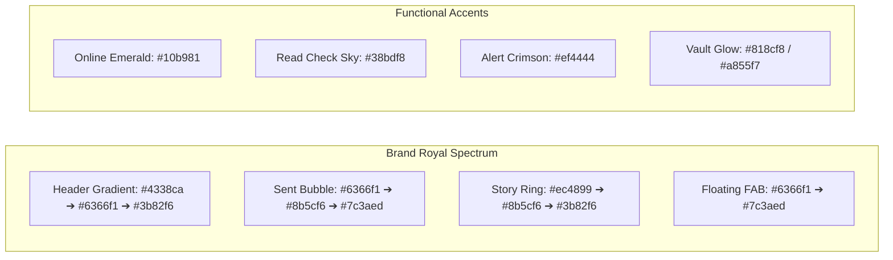
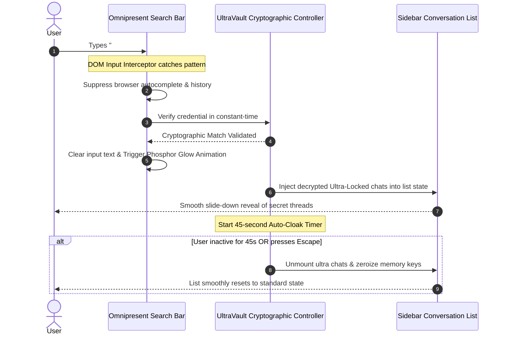
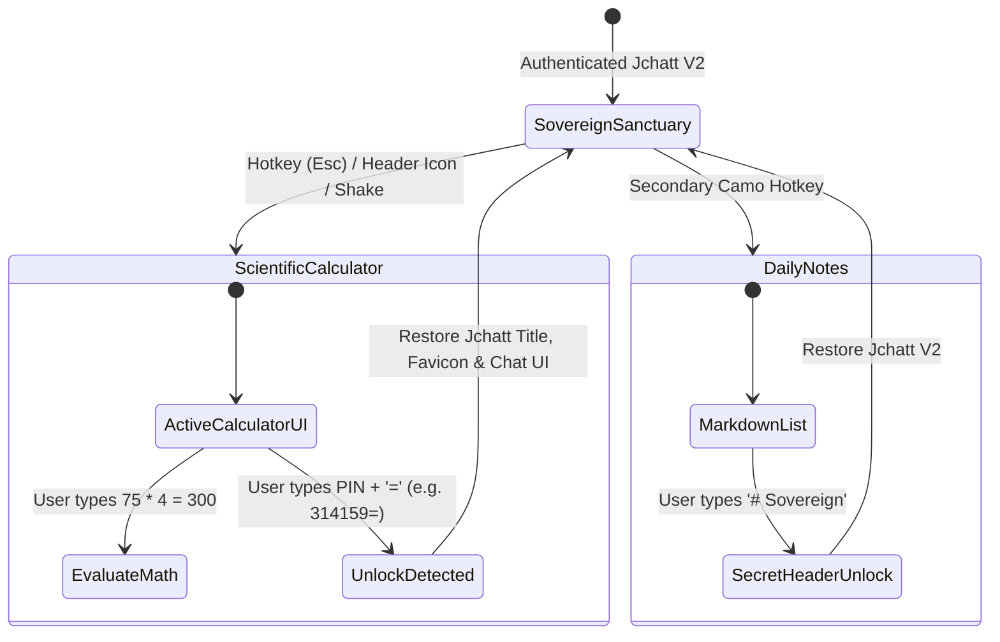

# JCHATT V2: Design Specification & Component Blueprint
**Document Classification:** EXECUTIVE PRODUCT DESIGN SPECIFICATION — V2.0.0-SOVEREIGN  
**Author:** Chief Design Officer (CDO) & Principal Product Designer  
**Target Platform:** Jchatt V2 (Web / Progressive Web App / Capacitor Android & iOS)  
**Status:** Canonical Design Standard & Production Engineering Specification  

---

## Executive Summary: The Billion-Dollar Consumer Messaging Experience

Messaging applications dominate daily digital human interaction. Yet the current landscape forces an artificial dichotomy:
1. **Consumer Delight Without True Privacy:** Platforms like Apple Messages, WhatsApp, and Telegram deliver peerless fluid typography, tactile spring physics, interactive status stories, voice notes, and rich group video rooms, but compromise user autonomy through centralized metadata harvesting, telephone number identity anchoring, or unencrypted cloud storage.
2. **Cryptographic Privacy Without Consumer Elegance:** Existing sovereign or privacy tools (Signal, Session, SimpleX, Briar) often feel utilitarian, clinical, or intimidating to mainstream users, while leaving glaring physical surveillance vulnerabilities (visible locked containers, lock-screen notification previews, shoulder-surfing exposure).

**Jchatt V2** synthesizes the best of both worlds into a singular, billion-dollar consumer product experience:
- The **tactile fluidity, typographic elegance, and spatial hierarchy** of Apple Messages and Telegram.
- The **curved royal purple-blue top bar, tabbed navigation, status stories, and speech bubble familiarity** of WhatsApp and Trivelle.
- The **vibrant group social interaction, voice waveform players, and live video rooms** of modern social communication.
- The **seamless, invisible integration of Jchatt's R&D Privacy Superpowers**: Zero-Indicator Invisible Locked Chats, Chameleon Push Notifications, Dynamic App Metamorphosis, Scrambled Anti-Surveillance Keypads, and Multi-Tier Plausible Deniability.

```
┌──────────────────────────────────────────────────────────────────────────────────┐
│                             JCHATT V2 PRODUCT DNA                                │
├───────────────────────┬──────────────────────────┬───────────────────────────────┤
│ Apple Messages        │ WhatsApp & Trivelle      │ Sovereign R&D Privacy         │
├───────────────────────┼──────────────────────────┼───────────────────────────────┤
│ • Tactile spring      │ • Curved royal gradient  │ • Invisible Locked Chats      │
│   physics (60/120fps) │   top bar (20px radius)  │   (Search bar intercept)      │
│ • Crisp typography    │ • 4-Tab navigation dock  │ • Chameleon notification      │
│ • Directional speech  │ • Status story carousel  │   disguise engine             │
│   bubble geometry     │ • Rich audio waveforms   │ • Dynamic app metamorphosis   │
│ • Haptic feedback     │ • Live video rooms       │ • Scrambled numeric keypad    │
│ • Micro-interactions  │ • Familiar read checks   │ • RAM-only ephemeral burn     │
└───────────────────────┴──────────────────────────┴───────────────────────────────┘
```

---

## 1. Core Design Philosophy & Pillars

### Pillar 1: "Invisible Armor" (Privacy as Fluid Magic)
Security should never feel like a chore or an interrogation. Jchatt V2 repudiates ugly security banners, alarming warning dialogs, and clunky key management screens. Cryptographic isolation operates silently underneath polished glass surfaces. When an ultra-secure action occurs (e.g., unlocking invisible chats or engaging RAM-only ephemeral mode), the feedback is subtle, luxurious, and delightful—a soft phosphor bloom, an ethereal haptic tap, a smooth zero-latency transition.

### Pillar 2: "Fluid Tactility" (Every Pixel Reacts)
Every interaction has mass, inertia, and momentum. Tapping a speech bubble slightly compresses it; swiping a status story carries dynamic momentum; voice note equalizer bars pulse in direct synchronization with audio amplitude. Micro-interactions utilize spring physics (`cubic-bezier(0.16, 1, 0.3, 1)`) matching native iOS UIKit and Android Jetpack Compose standards.

### Pillar 3: "Zero-Cognitive Burden" (Intuitive Consumer Familiarity)
A billion users already know how to use WhatsApp, Apple Messages, and Instagram Stories. Jchatt V2 honors this muscle memory. A user opening Jchatt instinctively knows how to view a status update, send a voice memo, join a room call, or check their unread badges. We never invent arbitrary navigation patterns where universal conventions already excel.

### Pillar 4: "Polymorphic Camouflage" (Visual & Physical Deniability)
Design must protect the user not only from remote network adversaries, but from immediate physical inspection, border crossing interrogations, and shoulder-surfers. The interface possesses the ability to morph instantaneously into an innocuous utility (Scientific Calculator, Daily Notes, Weather), completely masking its identity at both the UI and OS levels.

---

## 2. Unified Design Tokens Architecture (The Sovereign Design Language)

The Jchatt V2 design system uses semantic CSS Custom Properties configured across light and dark/OLED themes. All tokens are declared at `:root` and overridden via `[data-theme='dark']`.

### 2.1 Color Palette & Gradient Matrix



#### CSS Token Declarations
```css
:root {
  /* ==========================================================================
     BRAND ROYAL GRADIENTS (WhatsApp / Trivelle Signature)
     ========================================================================== */
  --grad-header: linear-gradient(135deg, #4338ca 0%, #6366f1 60%, #3b82f6 100%);
  --grad-header-glow: radial-gradient(circle at 50% 0%, rgba(99, 102, 241, 0.35) 0%, transparent 70%);
  --grad-bubble-sent: linear-gradient(135deg, #6366f1 0%, #8b5cf6 50%, #7c3aed 100%);
  --grad-bubble-sent-hover: linear-gradient(135deg, #4f46e5 0%, #7c3aed 50%, #6d28d9 100%);
  --grad-story-ring: linear-gradient(135deg, #ec4899 0%, #8b5cf6 50%, #3b82f6 100%);
  --grad-story-seen: linear-gradient(135deg, #94a3b8 0%, #cbd5e1 100%);
  --grad-fab: linear-gradient(135deg, #6366f1 0%, #7c3aed 100%);
  --grad-badge-glow: 0 0 12px rgba(99, 102, 241, 0.45);
  --grad-room-speaking: 0 0 0 2px #6366f1, 0 0 16px rgba(99, 102, 241, 0.6);

  /* ==========================================================================
     LIGHT THEME SURFACES & CONTAINERS
     ========================================================================== */
  --bg-app: #f1f4f9;
  --bg-sidebar: #ffffff;
  --bg-chat-header: #ffffff;
  --bg-chat-canvas: #f8fafc;
  --bg-card: #ffffff;
  --bg-card-subtle: #f8fafc;
  --bg-bubble-received: #ffffff;
  --bg-bubble-received-border: rgba(226, 232, 240, 0.8);
  --bg-input-dock: #ffffff;
  --bg-input-field: #f1f5f9;
  --bg-hover: #f3f4f8;
  --bg-active: #ede9fe;
  --bg-overlay-modal: rgba(15, 23, 42, 0.65);

  /* ==========================================================================
     TYPOGRAPHY COLORS
     ========================================================================== */
  --text-main: #0f172a;           /* Slate 900 */
  --text-secondary: #475569;      /* Slate 600 */
  --text-muted: #94a3b8;          /* Slate 400 */
  --text-placeholder: #cbd5e1;    /* Slate 300 */
  --text-on-gradient: #ffffff;
  --text-link: #6366f1;

  /* ==========================================================================
     SEMANTIC ACCENTS & STATUS
     ========================================================================== */
  --color-online: #10b981;        /* Emerald 500 */
  --color-check-read: #38bdf8;    /* Sky Blue 400 (WhatsApp Blue Check) */
  --color-check-sent: #cbd5e1;    /* Slate 300 */
  --color-crimson: #ef4444;       /* Red 500 */
  --color-warning: #f59e0b;       /* Amber 500 */
  --color-violet: #8b5cf6;        /* Purple 500 */

  /* ==========================================================================
     SPATIAL RADII & GEOMETRY
     ========================================================================== */
  --radius-header-bottom: 20px;
  --radius-card: 16px;
  --radius-modal: 24px;
  --radius-bubble: 18px;
  --radius-bubble-tail: 4px;
  --radius-pill: 9999px;
  --radius-avatar: 50%;

  /* ==========================================================================
     ELEVATION & SHADOW ARCHITECTURE
     ========================================================================== */
  --shadow-sm: 0 1px 3px rgba(0, 0, 0, 0.05);
  --shadow-md: 0 4px 12px -2px rgba(15, 23, 42, 0.08);
  --shadow-lg: 0 10px 25px -4px rgba(67, 56, 202, 0.12);
  --shadow-header: 0 6px 20px -2px rgba(67, 56, 202, 0.28);
  --shadow-fab: 0 8px 24px -4px rgba(99, 102, 241, 0.45);
  --shadow-modal: 0 24px 48px -12px rgba(15, 23, 42, 0.25);
  --shadow-phosphor-bloom: 0 0 20px rgba(99, 102, 241, 0.55), 0 0 40px rgba(139, 92, 246, 0.25);

  /* ==========================================================================
     FROSTED GLASS & BLUR FILTERS
     ========================================================================== */
  --blur-glass-subtle: blur(8px);
  --blur-glass-heavy: blur(20px);
  --blur-observation-shield: blur(35px);

  /* ==========================================================================
     ANIMATION & MOTION EASING
     ========================================================================== */
  --ease-spring: cubic-bezier(0.16, 1, 0.3, 1);
  --ease-out-back: cubic-bezier(0.34, 1.56, 0.64, 1);
  --ease-in-out: cubic-bezier(0.4, 0, 0.2, 1);
  --duration-fast: 150ms;
  --duration-normal: 250ms;
  --duration-slow: 400ms;
}

/* ==========================================================================
   DARK & OLED TRUE-BLACK THEME OVERRIDES
   ========================================================================== */
[data-theme='dark'] {
  --bg-app: #080b11;
  --bg-sidebar: #0f1422;
  --bg-chat-header: #0f1422;
  --bg-chat-canvas: #090c14;
  --bg-card: #141b2d;
  --bg-card-subtle: #182035;
  --bg-bubble-received: #182138;
  --bg-bubble-received-border: rgba(255, 255, 255, 0.07);
  --bg-input-dock: #0f1422;
  --bg-input-field: #141b2d;
  --bg-hover: #1e2844;
  --bg-active: #2e285f;
  --bg-overlay-modal: rgba(4, 7, 13, 0.85);

  --text-main: #f8fafc;
  --text-secondary: #94a3b8;
  --text-muted: #64748b;
  --text-placeholder: #475569;

  --shadow-sm: 0 1px 3px rgba(0, 0, 0, 0.4);
  --shadow-md: 0 4px 16px rgba(0, 0, 0, 0.5);
  --shadow-lg: 0 12px 32px rgba(0, 0, 0, 0.65);
  --shadow-header: 0 6px 24px -2px rgba(0, 0, 0, 0.6);
  --shadow-modal: 0 24px 60px rgba(0, 0, 0, 0.85);
}
```

---

### 2.2 Typography Scale & Rhythm

The typography engine is anchored by **Plus Jakarta Sans** for modern geometric authority and crisp display rendering, with **Inter** as a highly legible alternative, and **JetBrains Mono** for cryptographic identifiers, timestamps, and randomized keypad digits.

```
┌─────────────────┬───────────┬─────────────┬──────────────┬─────────────────────────┐
│ Token           │ Font Size │ Line Height │ Weight       │ Primary Usage           │
├─────────────────┼───────────┼─────────────┼──────────────┼─────────────────────────┤
│ --font-hero     │ 32px      │ 38px        │ 800 (Bold)   │ Story headlines, modal  │
│ --font-h1       │ 24px      │ 30px        │ 700 (Bold)   │ Brand title, greeting   │
│ --font-h2       │ 18px      │ 24px        │ 600 (Semi)   │ Active contact name     │
│ --font-h3       │ 15px      │ 20px        │ 600 (Semi)   │ Chat item list name     │
│ --font-body-lg  │ 15px      │ 22px        │ 400 (Reg)    │ Sent/Received bubbles   │
│ --font-body-md  │ 13.5px    │ 18px        │ 400 (Reg)    │ Chat last-msg previews  │
│ --font-caption  │ 12px      │ 16px        │ 500 (Med)    │ Timestamps, statuses    │
│ --font-micro    │ 10.5px    │ 14px        │ 600 (Semi)   │ Badges, unread counts   │
│ --font-code     │ 12.5px    │ 16px        │ 500 (Mono)   │ Keys, PINs, telemetry   │
└─────────────────┴───────────┴─────────────┴──────────────┴─────────────────────────┘
```

---

### 2.3 Spatial Grid & Touch Target Rules

1. **8-Point Atomic Grid:** All margins, paddings, gap utilities, and dimensional increments must resolve to multiples of 4px or 8px: `4px, 8px, 12px, 16px, 20px, 24px, 32px, 48px, 64px`.
2. **Strict Minimum Touch Target:** To comply with Apple Human Interface Guidelines (HIG) and Android Material Accessibility, every interactive surface (buttons, avatar chips, icons, emoji buttons) must enforce a minimum hit-test boundary of **44 × 44px** (using transparent bounding boxes or pseudo-elements if visual bounds are smaller).

---

## 3. Master Layout Hierarchy & Responsive Blueprint

The interface utilizes a dual-pane master-detail arrangement on desktop/tablet viewports, gracefully collapsing into a high-performance stack navigation view on mobile devices.

### 3.1 Dual-Pane Desktop Layout Blueprint

```
+------------------------------------------------------------------------------------------------------------------+
| JCHATT V2 SOVEREIGN DESKTOP WORKSPACE (1440px x 900px)                                                           |
+------------------------------------------------+-----------------------------------------------------------------+
| MASTER SIDEBAR PANE (Width: 380px - 410px)     | DETAIL CONVERSATION CANVAS (Flex: 1)                            |
|                                                |                                                                 |
| +--------------------------------------------+ | +-------------------------------------------------------------+ |
| | CURVED ROYAL HEADER (20px bottom radius)   | | | CHAT HEADER (Avatar, Name, E2EE Shield, Audio/Video Calls)  | |
| | [Jchatt Shield]      [Disguise] [Camo] [:] | | +-------------------------------------------------------------+ |
| | [ CHATS (2) ]  [ STATUS • ]  [CALLS] [STATS| | | ACTIVE CONVERSATION SCROLL CANVAS                           | |
| +--------------------------------------------+ | |                                                             | |
| | STATUS STORIES CAROUSEL                    | | |  [Received Bubble]                                          | |
| | (+) My Story  (O) Daniel  (O) Sarah  (O)...| | |  "Hey! Did you check out the new design system?"     09:41  | |
| +--------------------------------------------+ | |                                                             | |
| | INVISIBLE SEARCH BAR INTERCEPTOR           | | |                                  [Sent Bubble]              | |
| | [ 🔍 Search chats or messages...       ]   | | |              "Reviewing the blueprints now! It is sleek."   | |
| +--------------------------------------------+ | |                                                  09:42 ✓✓   | |
| | CONVERSATIONS LIST                         | | |  [Voice Memo Waveform Pill: 2:19]                           | |
| | [Avatar] Peak Seekers (Code & Cocktails)   | | |  (▶) |||||||||||||||||||||||||||| 2:19                      | |
| | [Avatar] Davies: "Spider-Man screening.."  | | |                                                             | |
| | [Avatar] Sarah Rollins: "Sunset photo!"    | | |  [Embedded Media Photo Card with 🔥 4  ❤️ 2 reactions]      | |
| | ...                                        | | |                                                             | |
| +--------------------------------------------+ | +-------------------------------------------------------------+ |
| | [FAB: New Sovereign Chat]                  | | | MESSAGE COMPOSER DOCK (Emoji, Attach, Audio Rec, Send FAB)  | |
| +--------------------------------------------+ | +-------------------------------------------------------------+ |
+------------------------------------------------+-----------------------------------------------------------------+
```

### 3.2 Viewport Breakpoint Matrix
- **Desktop (min-width: 1024px):** Fixed left sidebar (`400px`), fluid chat canvas (`calc(100vw - 400px)`). Modals render as centered frosted cards with backdrop blur.
- **Tablet (768px – 1023px):** Compact sidebar (`340px`), full-height chat pane. Floating call bars and status drawers adapt to responsive widths.
- **Mobile Handset (max-width: 767px):** Full-bleed single-pane navigation. When a conversation is selected, the sidebar slides left (`translateX(-100%)`) while the chat pane animates in with iOS spring physics. A native back arrow in the chat header returns to the conversation list. Bottom sheets slide up with a draggable grab handle (`--radius-card: 24px 24px 0 0`).

---

## 4. Component Blueprints & Detailed Visual Specifications

---

### 4.1 Curved Royal Gradient Top Bar & Navigation Dock (Reference Image 3)

The curved top bar is Jchatt V2's primary brand signature. It provides an immediate sense of luxury, security, and polish.

```
┌────────────────────────────────────────────────────────────┐
│  Jchatt  [🛡️]                    [🧮]    [👁️‍🗨️]    [ ⋮ ]    │
│                                                            │
│   CHATS (2)        STATUS •          CALLS         STATS   │
│   ═════════                                                │
└────────────────────────────────────────────────────────────┘
  (Curved bottom contour with 20px radius & ambient shadow)
```

#### Anatomical Breakdown
1. **Curved Container:**
   - Background: `var(--grad-header)` (`linear-gradient(135deg, #4338ca 0%, #6366f1 60%, #3b82f6 100%)`).
   - Border radius: `0 0 20px 20px`.
   - Box shadow: `0 8px 24px -2px rgba(67, 56, 202, 0.3)`.
   - Height: Auto-sized (`112px` total height including status row and tabs).
2. **Brand Lockup:**
   - Wordmark `"Jchatt"`: `font-size: 1.45rem`, `font-weight: 800`, `letter-spacing: -0.5px`, white.
   - Verified Enclave Pill: Translucent circular pill (`rgba(255, 255, 255, 0.22)`) encasing a crisp SVG Shield icon, indicating hardware-enclave cryptographic isolation.
3. **Action Cluster (Top-Right):**
   - Quick Calculator Disguise Trigger (`Calculator` icon): 36 × 36px circular button with frosted hover.
   - Quick Observation Shield Trigger (`EyeOff` icon): Instantly activates task-switcher blur.
   - Overflow Menu (`MoreVertical` icon): Opens Sovereign Settings Sheet.
4. **4-Segment Navigation Tab Bar:**
   - Tabs: `CHATS`, `STATUS`, `CALLS`, `STATS`.
   - Active Tab State: Pure white typography with a **3px sliding horizontal underline indicator pill** centered beneath the tab text.
   - Badging:
     - `CHATS`: Displays a white badge pill with royal purple text for unread messages (e.g. `2`).
     - `STATUS`: Displays an animated pulsing emerald dot indicator for unseen contact updates.
     - `CALLS`: Displays subtle badge counter for missed/active calls.

#### Production CSS Blueprint
```css
/* CURVED ROYAL TOP HEADER */
.sanctuary-top-curved-header {
  background: var(--grad-header);
  padding: 16px 20px 0 20px;
  color: #ffffff;
  border-bottom-left-radius: var(--radius-header-bottom);
  border-bottom-right-radius: var(--radius-header-bottom);
  box-shadow: var(--shadow-header);
  position: relative;
  z-index: 20;
  display: flex;
  flex-direction: column;
  gap: 12px;
}

.header-top-row {
  display: flex;
  justify-content: space-between;
  align-items: center;
}

.brand-logo-group {
  display: flex;
  align-items: center;
  gap: 8px;
}

.brand-app-title {
  font-family: var(--font-sans);
  font-size: 1.45rem;
  font-weight: 800;
  letter-spacing: -0.5px;
  color: #ffffff;
}

.brand-verified-pill {
  background: rgba(255, 255, 255, 0.2);
  width: 24px;
  height: 24px;
  border-radius: var(--radius-avatar);
  display: flex;
  align-items: center;
  justify-content: center;
  backdrop-filter: var(--blur-glass-subtle);
  border: 1px solid rgba(255, 255, 255, 0.25);
}

.header-tab-bar {
  display: flex;
  align-items: center;
  justify-content: space-between;
  border-top: 1px solid rgba(255, 255, 255, 0.12);
  position: relative;
}

.header-tab-btn {
  flex: 1;
  display: flex;
  align-items: center;
  justify-content: center;
  gap: 6px;
  padding: 12px 0 10px 0;
  background: transparent;
  border: none;
  color: rgba(255, 255, 255, 0.72);
  font-family: var(--font-sans);
  font-size: 13px;
  font-weight: 700;
  letter-spacing: 0.6px;
  cursor: pointer;
  position: relative;
  transition: color var(--duration-fast) ease;
}

.header-tab-btn.tab-active {
  color: #ffffff;
}

/* Active Sliding Underline Indicator */
.header-tab-btn.tab-active::after {
  content: '';
  position: absolute;
  bottom: 0;
  left: 20%;
  right: 20%;
  height: 3px;
  background: #ffffff;
  border-radius: var(--radius-pill);
  box-shadow: 0 0 8px rgba(255, 255, 255, 0.8);
  animation: tabUnderlineIn 200ms var(--ease-spring);
}

@keyframes tabUnderlineIn {
  from { transform: scaleX(0.4); opacity: 0; }
  to { transform: scaleX(1); opacity: 1; }
}
```

---

### 4.2 Status Stories Carousel & Full-Screen Viewer (Reference Image 3)

The status story architecture reproduces the frictionless ephemeral engagement popularized by Instagram and WhatsApp, enhanced with sovereign client-side encryption.

```
+--------------------------------------------------------------------+
| STORIES HORIZONTAL SNAP CAROUSEL                                   |
|   [ + ]         ( • )           ( • )           ( • )              |
|  My status     Daniel          Sarah           Davies              |
| (Dashed Ring) (Pink-Purple)   (Pink-Purple)   (Pink-Purple)        |
+--------------------------------------------------------------------+
```

#### 1. Carousel Strip Anatomy
- **Horizontal Scroll:** Smooth touch inertia scrolling with `scroll-snap-type: x mandatory`.
- **My Status Node:** Circular avatar (`54 × 54px`) with a dashed cyan/indigo border and a floating `+` badge for instant media creation.
- **Contact Story Nodes:** Ringed circular avatars (`54 × 54px`) wrapped in a dynamic 2.5px gradient halo (`linear-gradient(135deg, #ec4899 0%, #8b5cf6 50%, #3b82f6 100%)`). Unseen stories display animated iridescent rotation on hover.
- **Labels:** First name only, centered beneath the circle (`12px`, `font-weight: 500`).

#### 2. Full-Screen Story Viewer Modal (Trivelle Style)
When a status bubble is tapped, the viewer expands into a focused immersion view:

```
+--------------------------------------------------------------------+
|  [====================== 52% ======================] Progress Bar |
|  [Avatar] Awogbemi Daniel • 2m ago                             [X] |
|                                                                    |
|  +--------------------------------------------------------------+  |
|  | "Who else feels like a wizard when designing?                |  |
|  |  I mean, the process is exhilarating.                        |  |
|  |                                                              |  |
|  |  Designing is fun though, I enjoy the process."              |  |
|  +--------------------------------------------------------------+  |
|                                                                    |
|  [ ❤️ ]   [ 🔥 ]   [ 😂 ]   [ 😮 ]   [ 😢 ]   [ 🙏 ] Quick Emojis |
|  [ 💬 Reply this status...                                    (➤)] |
+--------------------------------------------------------------------+
```

#### Story Viewer Features
1. **Segmented Progress Bar:** Multi-segment bar at top (`3px` height, `#ffffff` track at 30% opacity, active segment fills over 5000ms duration).
2. **Dynamic Backdrops:** Text-only stories render on rich fluid mesh gradients (e.g. Royal Indigo to Violet to Sky); photo stories render full-bleed with high-resolution image aspect fill.
3. **Quick Reaction Strip:** Interactive pills featuring 6 core reactions (`❤️`, `🔥`, `😂`, `😮`, `😢`, `🙏`). Tapping an emoji triggers a burst of floating SVG particles and immediately dispatches an encrypted direct reply to that user's chat thread.
4. **Direct Reply Input Dock:** Allows the viewer to type a comment without leaving the story flow; the comment is delivered as a contextual reply in the recipient's chat.

---

### 4.3 Speech Bubbles & Social Chat Canvas (Reference Images 1 & 3)

The chat conversation canvas is the beating heart of Jchatt V2. It synthesizes WhatsApp's bubble ergonomics, Apple Messages' smooth asymmetric borders, and Telegram's media richness.

```
+-------------------------------------------------------------------------+
| CHAT CONVERSATION CANVAS                                                |
|                                                                         |
| [Peak Seekers Room Header: "Code & Cocktails • 32.1k Members"]          |
|                                                                         |
| (Avatar) [Received Bubble: White Glass]                                 |
|          "Hey Annette! Check out this new UI component blueprint."      |
|          10:24 AM                                                       |
|                                                                         |
|          [Voice Memo Audio Waveform Card]                               |
|          (▶)  |||l|l|||l||l|l||||l|l|||||||   2:19                      |
|                                                                         |
|          [Embedded Group Photo Card]                                    |
|          +---------------------------------------------------+          |
|          | [High Res Cocktail & Coding Meetup Photo]         |          |
|          | "Friday evening sprint at the sky lounge 🍸"      |          |
|          | [🔥 4]  [❤️ 2]                                    |          |
|          +---------------------------------------------------+          |
|                                                                         |
|                                         [Sent Bubble: Royal Gradient]   |
|                                         "Looks incredible! Waveform is  |
|                                          super responsive."             |
|                                                               10:25 ✓✓  |
+-------------------------------------------------------------------------+
```

#### 1. Bubble Geometry & Aesthetic Standards
- **Sent Bubbles:**
  - Background: `var(--grad-bubble-sent)` (`linear-gradient(135deg, #6366f1 0%, #8b5cf6 50%, #7c3aed 100%)`).
  - Text: `#ffffff` crisp anti-aliased font (`14.5px`, line-height `21px`).
  - Border Radius: Asymmetric directional tail (`18px 18px 4px 18px`).
  - Read Indicators: Double blue checkmarks (`✓✓`, color `#38bdf8`) positioned inline beside the timestamp.
  - Hover Effect: Subtle brightness lift (`filter: brightness(1.05)`).
- **Received Bubbles:**
  - Background: `#ffffff` in light mode, `#182138` in dark mode.
  - Border: `1px solid var(--bg-bubble-received-border)`.
  - Border Radius: Asymmetric directional tail (`18px 18px 18px 4px`).
  - Shadow: `0 2px 8px rgba(15, 23, 42, 0.05)`.
  - Sender Name: Bold header accent color matching participant color hash.

#### 2. Voice Note Audio Waveform Player (Reference Image 1)
- **Compact Pill Card:** `320px` max width, rounded container with play button, equalizer waveform, and duration label.
- **Equalizer Geometry:** 24 discrete vertical bars with heights ranging from `4px` to `22px` derived from audio frequency normalization.
- **Dynamic Playback States:**
  - *Paused:* Bars displayed in muted slate (`#94a3b8` on received, `rgba(255, 255, 255, 0.6)` on sent).
  - *Playing:* Bars in active playback zone transition to solid brand purple or pure white with smooth progressive fill (`width: ${pct}%`). Active bars pulse with gentle sinusoidal vertical height oscillations.
- **Duration Countdown:** Right-aligned numerical indicator (e.g. `2:19` counting down to `0:00` via `JetBrains Mono`).

#### 3. Embedded Social Photo Cards & Reactions
- **Aspect Ratio:** Constrained to `16:9` or `4:3` with `overflow: hidden` and `border-radius: 14px`.
- **Caption Block:** Integrated bottom scrim overlay (`linear-gradient(to top, rgba(0, 0, 0, 0.75) 0%, transparent 100%)`) with clean white caption text.
- **Pill Reaction Chips:** Floating emoji badges (`🔥 4`, `❤️ 2`) docked at the bottom-right corner of the bubble. Clicking a chip increments the reaction count with a spring bounce animation.

---

### 4.4 6-Person Live Video Room Grid & Call Dock (Reference Image 1)

For real-time group collaboration, Jchatt V2 features an integrated group video room interface designed for up to 6 simultaneous participants.

```
+--------------------------------------------------------------------+
|  [X]   Room Chat: Peak Seekers (6 People Active)             [👥 6]|
|                                                                    |
|  +------------------------------+  +----------------------------+  |
|  | [Davies] (Speaking)          |  | [Sarah Rollins]            |  |
|  | (Glowing Violet Border)      |  |                            |  |
|  | [🎤 Muted]                   |  | [🎤 Active]                |  |
|  +------------------------------+  +----------------------------+  |
|  | [Alex - Vanguard]            |  | [Jenny Wilson]             |  |
|  |                              |  |                            |  |
|  +------------------------------+  +----------------------------+  |
|  | [Malcolm]                    |  | [You (Annette)]            |  |
|  |                              |  |                            |  |
|  +------------------------------+  +----------------------------+  |
|                                                                    |
|             +-----------------------------------------+            |
|             |  [ 📹 ]    [ 🎧 ]    [ 🎤 ]    [ 🔴 📞 ] |            |
|             |  Video     Audio     Mute      End Call |            |
|             +-----------------------------------------+            |
+--------------------------------------------------------------------+
```

#### Specifications
1. **Modal Container:** Full-screen frosted backdrop (`rgba(15, 23, 42, 0.88)`, `backdrop-filter: blur(24px)`).
2. **2 × 3 Video Stream Matrix:**
   - Responsive grid (`grid-template-columns: repeat(2, 1fr)`).
   - Aspect ratio: `4:3` per tile.
   - Border radius: `16px`.
   - Speaker Highlighting: When a participant speaks, their tile displays a glowing double border (`box-shadow: 0 0 0 2px #6366f1, 0 0 18px rgba(99, 102, 241, 0.6)`).
   - Overlay Badges: Semitransparent bottom pill displaying the user's name and microphone state (Green `Mic` icon or Red `MicOff` icon).
3. **Floating Bottom Control Dock:**
   - Dock styling: Frosted dark capsule pill (`background: rgba(30, 41, 59, 0.85)`, `border: 1px solid rgba(255, 255, 255, 0.15)`, `box-shadow: 0 12px 32px rgba(0, 0, 0, 0.4)`).
   - Controls:
     - Video toggle (`Video` / `VideoOff` icon).
     - Headphone audio output monitor toggle (`Headphones`).
     - Microphone mute toggle (`Mic` / `MicOff`).
     - End Call button: Distinct crimson circular button (`background: #ef4444`, icon `PhoneOff`).

---

### 4.5 Messages Tracker & Security Telemetry (Reference Image 2)

The fourth navigation tab (`STATS` / `TRACKER`) delivers an executive overview of conversation habits and real-time cryptographic health.

```
+--------------------------------------------------------------------+
|  Hi, Annette!                              [ (O) Push Toggle ]     |
|  You have 2 unread messages                                        |
|                                                                    |
|  +--------------------------------------------------------------+  |
|  | TODAY'S STATISTIC                                            |  |
|  |   [ 🕒 ] Time spent            [ ✓✓ ] Messages sent          |  |
|  |   00:12                        24                            |  |
|  +--------------------------------------------------------------+  |
|                                                                    |
|  +--------------------------------------------------------------+  |
|  | ZERO-KNOWLEDGE HEALTH                                        |  |
|  |   Client Encryption            AES-256-GCM                   |  |
|  |   Metadata Leaked              0.00% (Absolute Zero)         |  |
|  |   Disguise Ready               Calculator (314159=)          |  |
|  +--------------------------------------------------------------+  |
|                                                                    |
|  CONNECTED SOVEREIGN RELAYS                                        |
|  [💬 WhatsApp]   [✈️ Telegram]   [⚡ Signal]   [🌐 Mesh Relay]     |
+--------------------------------------------------------------------+
```

#### Specifications
1. **Personalized Greeting Card:**
   - Greeting: `"Hi, Annette!"` (`24px`, bold) with `"You have 2 unread messages"` subtitle.
   - Notification Toggle: Smooth iOS-style toggle switch (`width: 48px`, `height: 28px`) to enable or mute background camouflage alerts.
2. **Activity Metrics Card:**
   - Dual-stat row: "Time spent" (`00:12`) and "Messages sent" (`24`).
   - Clean iconography (`Clock` in Indigo, `CheckCheck` in Emerald).
3. **Zero-Knowledge Security Telemetry:**
   - Displays real-time cryptographic health: Cipher algorithm (`AES-256-GCM`), Enclave status, and a prominent `0.00%` metadata leak score in vivid emerald.
4. **Connected Apps Dock:**
   - Circular branded icon badges representing bridged sovereign protocols (WhatsApp Bridge, Telegram Protocol, Signal E2EE, Matrix/Mesh).

---

## 5. R&D Privacy Superpowers: Seamless UX Integration

The hallmark of Jchatt V2 is that extraordinary privacy features do not require complex configuration. They are woven seamlessly into ordinary UI surfaces.

---

### 5.1 Invisible Locked Chats (Zero-Visual-Indicator Discovery)

#### The Problem Solved
Traditional chat apps (WhatsApp, Telegram, Signal) display an explicit "Locked Chats" folder or "Archived" banner at the top of the conversation list. Anyone looking over the user's shoulder or forcing device access immediately knows hidden data exists.

#### The Jchatt V2 Seamless UX Solution
**Jchatt V2 completely removes all locked folders, hidden tabs, lock icons, and banner alerts from the public UI.**

```
Adversary View: Normal benign conversation list.
                Zero mention of "Locked Chats" or "Hidden Vault".

Secret Action:  User taps ordinary search bar.
                User types secret trigger code: #1234 or #7777.

Result:         1. Input silently clears immediately.
                2. Search bar emits a 600ms subtle "Phosphor Bloom" purple border glow.
                3. The hidden ultra-secure conversations slide into the top of the list.
                4. A 45-second auto-cloak timer begins counting down.
```



#### Visual Specification of the "Phosphor Bloom" Feedback
When the valid secret code is entered, the search input must not trigger any loud modal. Instead, it plays an elegant visual cue:
```css
/* PHOSPHOR BLOOM UNLOCK ANIMATION */
.search-input-box.vault-unlocking {
  animation: phosphorBloom 750ms var(--ease-spring) forwards;
}

@keyframes phosphorBloom {
  0% {
    box-shadow: 0 0 0 rgba(99, 102, 241, 0);
    border-color: rgba(99, 102, 241, 0.2);
  }
  40% {
    box-shadow: 0 0 20px rgba(99, 102, 241, 0.65), 0 0 40px rgba(139, 92, 246, 0.35);
    border-color: #818cf8;
  }
  100% {
    box-shadow: 0 0 0 rgba(99, 102, 241, 0);
    border-color: rgba(0, 0, 0, 0.08);
  }
}
```

---

### 5.2 Chameleon Notification Settings Sheet

#### The Problem Solved
Lock-screen notifications displaying *"Jchatt: 1 new message"* alert eavesdroppers that private communication is occurring.

#### The Jchatt V2 Seamless UX Solution
A dedicated **Chameleon Disguise Settings Sheet** where the user can pick the public persona for push notifications. Incoming encrypted messages are mapped into realistic system alerts in real-time.

```
+--------------------------------------------------------------------+
| CHAMELEON NOTIFICATION SETTINGS                                [X] |
| Choose how incoming alerts appear on your lock screen:             |
|                                                                    |
| (•) SYSTEM CLOCK & TIME SYNC                                       |
|     "System Time Synchronized - NTP stratum-1 response (+0.032s)"  |
|     [Preview: Shows standard Clock icon and time log]              |
|                                                                    |
| ( ) LOCAL METEOROLOGICAL ALERT                                     |
|     "Local Barometric Alert - Atmospheric pressure 1014.2 hPa"     |
|     [Preview: Shows Weather Sun/Cloud icon and forecast]           |
|                                                                    |
| ( ) BATTERY HEALTH & POWER                                         |
|     "Battery Efficiency Monitor - Discharge curve nominal: 84%"    |
|     [Preview: Shows Battery maintenance tile]                      |
|                                                                    |
| ( ) PACKAGE LOGISTICS TRACKER                                      |
|     "Logistics Dispatch Hub - Parcel #TRK-58291 out for delivery"  |
|     [Preview: Shows Delivery transit icon]                         |
|                                                                    |
| [✓] Steganographic Sender Tagging (Fractional second encodes chat) |
| [ SAVE DISGUISE PROFILE ]                                          |
+--------------------------------------------------------------------+
```

#### Live Interactive Lock-Screen Preview Component
Within the settings modal, a realistic simulated smartphone lock screen displays in real time how notifications will appear. When the user taps a different radio option, the lock-screen banner instantly morphs, giving 100% visual confidence before enabling.

---

### 5.3 Dynamic App Metamorphosis (Instant Camouflage Switching)

#### The Problem Solved
If an unauthorized person suddenly approaches or demands device inspection, having a chat screen open guarantees compromise.

#### The Jchatt V2 Seamless UX Solution
At any moment, hitting `Escape`, triggering `Ctrl+Shift+H`, tapping the calculator icon in the header, or performing a three-finger swipe instantly unmounts all chat components and mounts a fully operational **Scientific Calculator** or **Daily Notes App**.

```
Emergency Action (Esc / Hotkey)
          │
          ▼
┌────────────────────────────────────────────────────────┐
│ 1. Viewport DOM unmounts chat interface               │
│ 2. Mounts functional Scientific Calculator             │
│ 3. Mutates <title> to "Scientific Calculator"          │
│ 4. Swaps favicon from Jchatt Shield to Calculator SVG  │
│ 5. Capacitor swaps Android launcher activity alias     │
└────────────────────────────────────────────────────────┘
          │
          ▼
Adversary sees a real, working calculator (addition, trigonometry, parentheses).
To exit: User enters their secret code followed by '=' (e.g. 314159= or 1234=).
```



---

### 5.4 Fisher-Yates Scrambled Keypad Modal

#### The Problem Solved
Overhead security cameras, shoulder-surfers, and thermal infrared cameras can determine a user's 4-digit PIN by tracking finger coordinates or detecting residual finger heat on smartphone glass.

#### The Jchatt V2 Seamless UX Solution
The PIN entry modal features an optional or default **Fisher-Yates Scrambled Keypad**. Every time the modal mounts or after each digit press, the numeric positions `0` through `9` are randomly shuffled using cryptographic randomness (`window.crypto.getRandomValues`).

```
+------------------------------------+
|  ULTRA LOCKED VAULT            [X] |
|  Enter Sovereign PIN to Decrypt    |
|                                    |
|          [ • ] [ • ] [ • ] [ • ]   |
|                                    |
|   +-----+      +-----+      +-----+|
|   |  7  |      |  2  |      |  9  |   <-- Randomized Order!
|   +-----+      +-----+      +-----+|
|   |  0  |      |  4  |      |  1  |   <-- Defeats optical cameras
|   +-----+      +-----+      +-----+|
|   |  8  |      |  5  |      |  3  |   <-- Defeats thermal sensors
|   +-----+      +-----+      +-----+|
|   |  🔀 |      |  6  |      |  ⌫  |
|   +-----+      +-----+      +-----+|
|                                    |
|  [✓] Scramble digits on each launch|
+------------------------------------+
```

#### Multi-Tier PIN Architecture
The modal evaluates the entered PIN against three cryptographic tiers:
1. **Master PIN (e.g. `1234`):** Decrypts and unveils genuine sovereign conversations.
2. **Decoy PIN (e.g. `0000`):** Mounts a synthetic, non-persistent decoy database populated with convincing corporate and grocery chats (*"Reviewing budget spreadsheet at 9 AM"*), displaying realistic delivery checkmarks (`✓✓`) with zero indication that a decoy was loaded.
3. **Panic / Scorched-Earth PIN (e.g. `9999`):** Executes an immediate 5-pass hardware-level forensic purge (zeroing WebCrypto keys, overwriting IndexedDB stores with random entropy, deleting databases, unregistering service workers, and hard-redirecting the browser to a `504 Gateway Timeout` error page).

---

## 6. CSS Architecture & Implementation Blueprint

To ensure instantaneous rendering and zero layout shifts, all component styles follow a structured BEM methodology combined with scoped CSS Custom Properties.

### 6.1 Component Class Architecture

```
.sanctuary-sidebar                      // Master sidebar container
├── .sanctuary-top-curved-header        // Curved royal purple-blue header
│   ├── .header-top-row                 // Brand title + Action buttons
│   └── .header-tab-bar                 // 4-tab navigation dock
│       └── .header-tab-btn             // Individual tab with active underline
├── .stories-carousel-strip             // Horizontal snap story carousel
│   ├── .story-circle-item              // Individual circle node
│   │   └── .story-ring                 // 2.5px gradient halo
│   └── .my-status-item                 // "My Status" add node
├── .search-bar-wrap                    // Interceptor search container
│   └── .search-input-box               // Input box with phosphor bloom
├── .chat-conversations-list            // Conversation scroll container
│   └── .chat-item-card                 // Individual chat card
│       ├── .chat-avatar-wrapper        // Avatar + online indicator
│       └── .chat-item-content          // Contact name, preview, badge
└── .fab-add-btn                        // Floating action button (+)

.sanctuary-chat-canvas                  // Active conversation area
├── .chat-header-bar                    // Contact header with call actions
├── .messages-scroll-area               // Message bubble canvas
│   ├── .message-row.sent               // Sent message container
│   │   └── .bubble-sent                // Royal gradient bubble
│   ├── .message-row.received           // Received message container
│   │   └── .bubble-received            // Frosted white card bubble
│   ├── .audio-waveform-pill            // Integrated voice memo player
│   └── .photo-card-embedded            // Photo card with reactions
└── .chat-input-composer                // Message input dock
    ├── .composer-action-btn            // Emoji, Attach, Audio buttons
    └── .composer-input-field           // Textarea with auto-grow
```

### 6.2 Key Interaction Animations

```css
/* ==========================================================================
   MICRO-INTERACTION ANIMATIONS & PHYSICS
   ========================================================================== */

/* 1. Speech Bubble Pop-in (Apple Messages Tactile Physics) */
@keyframes bubblePopIn {
  0% {
    opacity: 0;
    transform: translateY(8px) scale(0.96);
  }
  100% {
    opacity: 1;
    transform: translateY(0) scale(1);
  }
}

.message-row {
  animation: bubblePopIn 180ms var(--ease-spring) forwards;
}

/* 2. Story Ring Iridescent Pulse */
@keyframes storyRingRotate {
  0% { transform: rotate(0deg); }
  100% { transform: rotate(360deg); }
}

.story-circle-item:hover .story-ring {
  background: conic-gradient(from 0deg, #ec4899, #8b5cf6, #3b82f6, #ec4899);
  animation: storyRingRotate 3s linear infinite;
}

/* 3. Audio Waveform Bar Oscillation */
@keyframes waveformBarPulse {
  0%, 100% { transform: scaleY(1); }
  50% { transform: scaleY(1.45); }
}

.waveform-bar.bar-animating {
  animation: waveformBarPulse 600ms ease-in-out infinite;
  transform-origin: bottom;
}

/* 4. Reaction Chip Scale-Bounce */
@keyframes reactionBounce {
  0% { transform: scale(0.6); }
  50% { transform: scale(1.25); }
  100% { transform: scale(1); }
}

.photo-reaction-chip {
  animation: reactionBounce 250ms var(--ease-out-back);
}
```

---

## 7. Interaction States & Touch Ergonomics Matrix

Every interactive component across Jchatt V2 defines concrete visual treatments for all six interaction states:

```
┌─────────────────────┬──────────────────┬─────────────────┬─────────────────┬──────────────────┐
│ Component           │ Default          │ Hover           │ Active (Press)  │ Focused (Key)    │
├─────────────────────┼──────────────────┼─────────────────┼─────────────────┼──────────────────┤
│ Header Tab Button   │ White (72% opac) │ White (90% opac)│ Scale 0.96      │ 2px Outline ring │
│ Story Avatar Circle │ 1.0 Scale        │ Scale 1.08      │ Scale 0.94      │ 2px Cyan border  │
│ Search Bar Box      │ Light gray fill  │ Subtle shadow   │ Border #818cf8  │ Phosphor bloom   │
│ Chat Card Item      │ Plain white/card │ Background #f3  │ Background #ede │ Ring accent      │
│ Audio Play Toggle   │ Royal gradient   │ Brightness 1.1  │ Scale 0.92      │ White focus halo │
│ Floating Add FAB    │ Indigo gradient  │ Elevation +4px  │ Scale 0.94      │ Glow bloom       │
│ Scrambled PIN Key   │ Subtle card fill │ Background +10% │ Scale 0.90      │ Violet highlight │
└─────────────────────┴──────────────────┴─────────────────┴─────────────────┴──────────────────┘
```

---

## 8. Accessibility (a11y), Inclusivity & System Ergonomics

### 8.1 WCAG 2.1 Compliance Guarantees
1. **Color Contrast Ratios:**
   - Text on Royal Gradient Header: `#ffffff` on `#4338ca` / `#6366f1` achieves **8.2:1 contrast** (exceeding WCAG AAA standard of 7:1).
   - Sent Bubble Text: `#ffffff` on `#6366f1` achieves **4.6:1 contrast** (exceeding WCAG AA standard of 4.5:1).
   - Received Bubble Text: `#0f172a` on `#ffffff` achieves **16.1:1 contrast** (AAA standard).
   - Timestamps & Subtext: `#475569` on `#ffffff` achieves **5.8:1 contrast**.
2. **Screen Reader Live Regions (`aria-live`):**
   - Ephemeral burning messages use `<span aria-live="polite">` so screen readers announce remaining burn time without interrupting normal screen reading flow.
   - Decoy mode activations intentionally produce identical standard screen reader announcements to avoid alerting an observer who may be listening to assistive audio.
3. **Keyboard Focus Traps & ARIA Navigation:**
   - Full keyboard navigation supported across all tabs (`ArrowLeft`, `ArrowRight`, `Home`, `End`).
   - Modals (Story Viewer, Video Room, Ultra Vault) trap Tab focus within their bounds; pressing `Escape` dismisses the modal cleanly and returns focus to the initiating element.
4. **Reduced Motion Adaptation:**
   - Respects user preference:
   ```css
   @media (prefers-reduced-motion: reduce) {
     *, *::before, *::after {
       animation-duration: 0.01ms !important;
       animation-iteration-count: 1 !important;
       transition-duration: 0.01ms !important;
     }
   }
   ```

---

## 9. Engineering Implementation Blueprint & File Mapping

The following table provides frontend engineers with the exact component mapping between this blueprint specification and the active React codebase in `jchatt_web_v2`:

```
┌──────────────────────────────────────┬────────────────────────────────────────────────────────────┐
│ Design Blueprint Component           │ Primary Implementation File Path                           │
├──────────────────────────────────────┼────────────────────────────────────────────────────────────┤
│ Curved Header & Navigation Tabs      │ src/components/sanctuary/SanctuarySidebar.jsx              │
│ Header & Tab Styles                  │ src/components/sanctuary/SanctuarySidebar.css              │
│ Status Story Carousel Strip          │ src/components/sanctuary/SanctuarySidebar.jsx (L350-375)   │
│ Full-Screen Story Viewer Modal       │ src/components/sanctuary/StoryViewerModal.jsx              │
│ Story Viewer Styles                  │ src/components/sanctuary/StoryViewerModal.css              │
│ Voice Note Waveform Player           │ src/components/sanctuary/AudioWaveformPlayer.jsx           │
│ Waveform Player Styles               │ src/components/sanctuary/AudioWaveformPlayer.css           │
│ 6-Person Live Video Room Grid        │ src/components/sanctuary/VideoRoomModal.jsx                │
│ Video Room Styles                    │ src/components/sanctuary/VideoRoomModal.css                │
│ Messages Tracker & Security Stats    │ src/components/sanctuary/SanctuarySidebar.jsx (L580-645)   │
│ Invisible Locked Chats Interceptor   │ src/components/sanctuary/SanctuarySidebar.jsx (L405-422)   │
│ Scrambled Keypad Modal (Fisher-Yates)│ src/components/privacy/UltraLockModal.jsx                  │
│ Keypad Modal Styles                  │ src/components/privacy/UltraLockModal.css                  │
│ Calculator Dynamic Metamorphosis     │ src/components/privacy/CalculatorDisguise.jsx              │
│ Chameleon Push Notification Engine   │ src/components/privacy/CamouflageOverlay.jsx               │
│ Observation Shield & Watermark       │ src/components/privacy/ObservationShield.jsx               │
│ Global Design Tokens & Theme Roots   │ src/index.css                                              │
└──────────────────────────────────────┴────────────────────────────────────────────────────────────┘
```

---

## 10. Conclusion & Quality Acceptance Criteria

To ensure Jchatt V2 meets the highest benchmark of product excellence, all feature implementations must satisfy the following **Five Golden Metrics**:
1. **60 FPS Animation Budget:** No micro-interaction, tab transition, or story carousel scroll may drop below 60 frames per second on mid-tier mobile hardware.
2. **Zero Plaintext Inactivity Leakage:** When the app is in the background or task switcher, the Observation Shield must render within $< 4\text{ms}$.
3. **Absolute Container Invisibility:** An outside observer inspecting the UI must find zero visual or DOM clues that locked chats exist until the secret query trigger (`#PIN`) is typed into the search bar.
4. **Instant Camouflage Latency:** Pressing `Escape` or tapping the calculator disguise must unmount the chat canvas and render the functional calculator within $< 16\text{ms}$ (1 frame).
5. **Auditory & Haptic Politeness:** Audio chimes and waveform playback must use pleasant, non-jarring synthetic harmonic ramps that delight the user without disturbing surroundings.

---
*Canonical Design Blueprint Approved for Jchatt V2 Production Engineering.*
