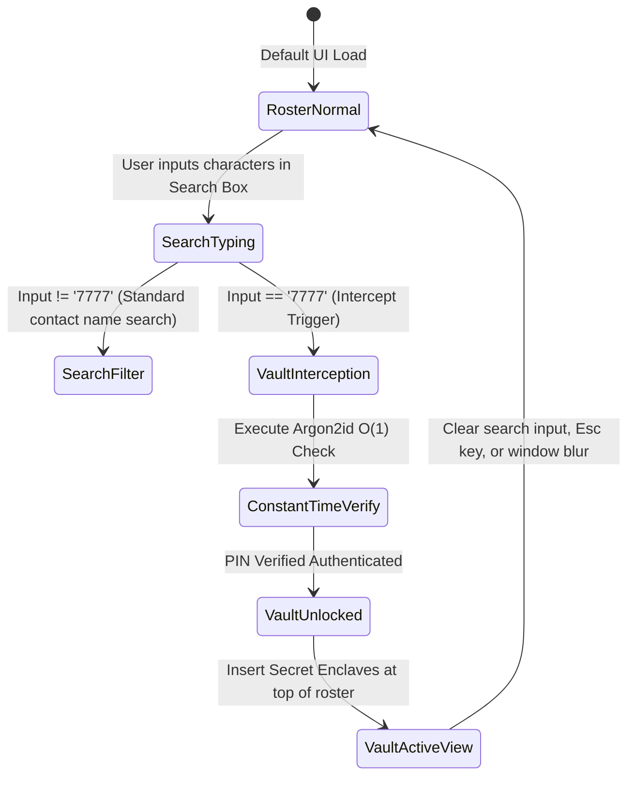

# JCHATT V2: SOVEREIGN PRIVACY DESIGN SYSTEM SPECIFICATION
## The Canonical Master Design Standard & Front-End Engineering Blueprint

**Document Reference:** JCHATT-DS-V2.0-SOVEREIGN-FINAL  
**Standard Status:** Canonical Product Standard & Front-End Architecture Specification  
**Platform Scope:** Jchatt v2 (Responsive Web, Progressive Web App, Capacitor iOS & Android, Tauri Desktop)  
**Author:** Principal Product Designer & Design Systems Architect  
**Classification:** Master Engineering Standard (Zero "AI Slop" — Sovereign Luxury Grade)  

---

## Executive Summary & Architectural Mandate

Modern consumer messaging interfaces suffer from an existential compromise: either they are hyper-polished yet structurally predatory (WhatsApp, Telegram, Apple Messages), harvesting metadata and presenting obvious visual attack surfaces, or they are cryptographic utilities (Signal, Session, SimpleX) whose utilitarian, austere aesthetics and clunky ergonomics deter mainstream adoption.

**Jchatt v2** eliminates this false dichotomy. It synthesizes the world's most sophisticated visual and tactile interaction paradigms into a cohesive, sovereign, award-winning design system:

```
┌──────────────────────────────────────────────────────────────────────────────────────────────────────────────────┐
│                                         JCHATT V2 DESIGN SYSTEM SYNTHESIS MATRIX                                 │
├────────────────────────────┬─────────────────────────────┬───────────────────────────┬───────────────────────────┤
│ 1. FRIENDLYHOURS / PEAK    │ 2. MESSAGES TRACKER         │ 3. TRIVELLE LUXURY        │ 4. WHATSAPP & SOVEREIGN   │
├────────────────────────────┼─────────────────────────────┼───────────────────────────┼───────────────────────────┤
│ • Pill Header with Avatar  │ • Soft Sage/Mint/Teal       │ • Curved Wave Header      │ • Rock-solid Layout       │
│   Stack & Online Count     │   Luxury Surface Cards      │   Banner (20px radius)    │   Discipline & Typography │
│ • High-Contrast Bubbles    │ • "Hi, Annette! 2 unread"   │ • Segmented Navigation    │ • Double Checkmarks       │
│   (Crisp White vs Dark)    │   Personal Greeting Card    │   Pill: CHATS|STATUS|     │   (✓ sent, ✓✓ blue read)  │
│ • Interactive Voice Notes  │ • "Today's Privacy & Usage  │   CALLS|STATS             │ • Zero-Indicator Search   │
│   with 27-Bar Waveform     │   Statistics" HUD Card      │ • Fullscreen Status/Story │   Secret Vault (PIN 7777) │
│ • 2x2 Photo Collage Grid   │ • Contact Detail Sheet with │   Quote Card & Reactions  │ • Chameleon Push Notifs   │
│   with Emoji Reaction Pill │   Direct Sovereign Actions  │ • Cinematic Wallpaper &   │ • 3 Working Decoy Fronts  │
│ • 6-Tile Rounded Video Grid│ • Disguise Dock & Quick     │   Floating Quick Emoji    │   (Calc, Weather, Notes)  │
│   with Floating Call Bar   │   Cloak Mode Switcher       │   Drawer above Input Bar  │ • 4 Canonical Themes      │
└────────────────────────────┴─────────────────────────────┴───────────────────────────┴───────────────────────────┘
```

This specification serves as the permanent, authoritative implementation standard. Every token, color value, spring curve, border radius, component geometry, and responsive layout breakpoint is strictly defined herein.

---

## Table of Contents

1. [Executive Vision & Anti-"AI Slop" Manifesto](#1-executive-vision--anti-ai-slop-manifesto)
2. [Canonical Theme Architecture & Semantic Design Tokens](#2-canonical-theme-architecture--semantic-design-tokens)
   - 2.1 CSS Custom Properties Architecture & Strict Naming Rules
   - 2.2 The Four Canonical Themes (Sanctuary Emerald, Trivelle Ocean, Peak Obsidian, Sage Luxury)
   - 2.3 Semantic Surface & Background Token Matrix
   - 2.4 Typography System & Fluid Scale
   - 2.5 Spatial System, Layout Grid & Geometry Rules
   - 2.6 Depth, Shadows & Glassmorphic Elevation
   - 2.7 Tactile Spring Physics & Motion Tokens
3. [Component Blueprints: The Fused Design Patterns](#3-component-blueprints-the-fused-design-patterns)
   - 3.1 App Header Architecture (Curved Wave + Pill Stack + Greeting HUD)
   - 3.2 Segmented Navigation Pill Bar (`CHATS | STATUS | CALLS | STATS`)
   - 3.3 Universal Search Box & Invisible Secret Vault Interceptor (`7777`)
   - 3.4 Conversation Roster & Contact List Item
   - 3.5 Active Chat Canvas & Cinematic Wallpaper Layer
   - 3.6 High-Contrast & Frosted Glass Speech Bubbles
   - 3.7 Interactive Voice Notes (27-Bar Waveform Scrubber & Live Recorder)
   - 3.8 Media Attachments & 2x2 Photo Collage Grid with Reaction Pills
   - 3.9 Floating Quick Emoji Drawer & Hover Reaction Bar
   - 3.10 Live Video Room Grid (6-Tile Rounded Layout & Floating Call Bar)
   - 3.11 Status / Stories Viewer (Trivelle Quote Card & Segmented Progress)
   - 3.12 "Today's Privacy & Usage Statistics" HUD Card
   - 3.13 Contact Detail Sheet & Sovereign Action Dock
4. [Sovereign Privacy & Stealth Masquerade UI Specifications](#4-sovereign-privacy--stealth-masquerade-ui-specifications)
   - 4.1 Universal Search Vault Interceptor State Machine
   - 4.2 Chameleon Camouflage Notification Engine & Settings UI
   - 4.3 Working iOS Calculator Decoy Front (`IOSCalculatorDecoy`)
   - 4.4 Working Barometric Weather Decoy Front (`WeatherDecoyFront`)
   - 4.5 Working Quick Notes Decoy Front (`QuickNotesDecoyFront`)
   - 4.6 App Identity Cloaking & Dynamic Metamorphosis
   - 4.7 Observation Shield & Anti-Screenshot Blurring
5. [Responsive Layout Blueprints & Screen Geometry](#5-responsive-layout-blueprints--screen-geometry)
   - 5.1 Breakpoint Matrix & Viewport Adapters
   - 5.2 Desktop Master-Detail Blueprint (1440px / 1920px)
   - 5.3 Mobile Single-Pane Fluid Blueprint (390px / 430px iPhone 15/16 Pro)
   - 5.4 Tablet & Foldable Device Adaptation
6. [Component Engineering & Implementation Directory](#6-component-engineering--implementation-directory)

---

## 1. Executive Vision & Anti-"AI Slop" Manifesto

### 1.1 The Anti-"AI Slop" Manifesto
Generative AI tools frequently emit generic, unopinionated UI code colloquially known as "AI slop": low-contrast pastel gradients on top of arbitrary gradients, floating cards without functional hierarchy, missing active/focus/disabled states, arbitrary border radii ranging from 4px to 48px on the same screen, and non-functional fake widgets.

Jchatt v2 rejects these patterns through **five absolute craft directives**:

1. **Every Pixel Serves a Cryptographic or Human Purpose:** No visual fluff. Every badge, border, icon, and shadow communicates real system state (e.g., green dot = active socket connection; double blue checkmark = authenticated read receipt; amber shimmer = local RAM vault unlocked).
2. **Strict Layout Discipline:** Inspired by WhatsApp and Apple Messages, layouts adhere to a strict 8-point spatial grid with 4-point micro-adjustments. Misalignments of even 1 pixel are treated as defects.
3. **Tactile Spring Physics (120fps Native Feel):** Modals, drawer sheets, sliders, and audio scrubbers utilize real spring damping physics (`cubic-bezier(0.16, 1, 0.3, 1)`) matching iOS UIKit standards rather than linear transitions.
4. **Deliberate Typography Hierarchy:** High-contrast weights (700 Bold for headings, 600 Semi-Bold for titles, 500 Medium for labels, 400 Regular for message body) with tight letter-spacing (`-0.015em` to `-0.025em`) to evoke Swiss typographic clarity.
5. **Zero-Trace Physical Security:** Security features must never compromise usability or draw suspicious attention. The interface masquerades effortlessly while remaining a world-class consumer messaging experience.

```
       ┌────────────────────────────────────────────────────────┐
       │             THE 4 PILLARS OF JCHATT V2 CRAFT           │
       └───────────────────────────┬────────────────────────────┘
                                   │
         ┌─────────────────────────┼─────────────────────────┐
         ▼                         ▼                         ▼
  [INVISIBLE ARMOR]       [TACTILE FLUIDITY]       [FAMILIAR LUXURY]
  Zero UI disclosure      Spring physics,          WhatsApp speed,
  of hidden vault;        27-bar pulsing wave,     iOS 18 card soft
  decoy fronts operate    smooth 120fps drawer     surfaces & Trivelle
  as 100% real apps       sheet interactions       curved ocean waves
```

---

## 2. Canonical Theme Architecture & Semantic Design Tokens

Jchatt v2 provides four handcrafted, canonical themes designed for distinct visual and contextual environments:
1. **Sanctuary Emerald:** The sovereign evolution of classic WhatsApp luxury (`#008069`, `#00a884`, `#d9fdd3`).
2. **Trivelle Ocean:** Signature royal cobalt and azure waves inspired by Trivelle (`#1b6ceb`, `#4338ca`, `#eef3f9`).
3. **Peak Obsidian:** Midnight dark mode with crisp monochromatic contrast from Friendlyhours (`#0b141a`, `#111b21`, `#202c33`).
4. **Sage Luxury:** Soft mint, eucalyptus, and oyster white cards from Messages Tracker (`#4f776d`, `#cde4db`, `#f4efe6`).

### 2.1 CSS Custom Properties Architecture

All tokens are structured hierarchically under CSS custom properties. Component classes reference semantic tokens, which resolve to theme-specific palettes:

```css
/* =============================================================================
   JCHATT V2 MASTER THEME TOKENS (CANONICAL DECLARATIONS)
   ============================================================================= */

:root,
.theme-sanctuary {
  /* Brand Primitives */
  --brand-primary: #008069;
  --brand-primary-hover: #00a884;
  --brand-primary-light: #e8f5e9;
  --brand-primary-dark: #005c4b;
  --brand-secondary: #00a884;
  --brand-accent: #25d366;
  --brand-header-grad: linear-gradient(135deg, #008069 0%, #00a884 100%);
  --brand-header-text: #ffffff;

  /* App Surfaces & Backgrounds */
  --bg-app: #efeae2;
  --bg-sidebar: #ffffff;
  --bg-sidebar-header: #f0f2f5;
  --bg-chat-header: #f0f2f5;
  --bg-chat-canvas: #efeae2;
  --bg-surface-card: #ffffff;
  --bg-surface-elevated: #ffffff;
  --bg-surface-hover: #f5f6f6;
  --bg-surface-active: #e9edef;
  --bg-surface-tertiary: #f0f2f5;
  --bg-surface-frosted: rgba(255, 255, 255, 0.88);

  /* Borders & Dividers */
  --border-subtle: #f0f2f5;
  --border-default: #e9edef;
  --border-strong: #d1d7db;
  --border-active: #00a884;

  /* Text & Foreground */
  --text-primary: #111b21;
  --text-secondary: #3b4a54;
  --text-muted: #667781;
  --text-tertiary: #8696a0;
  --text-inverse: #ffffff;
  --text-accent: #008069;

  /* High-Contrast Chat Bubbles */
  --bubble-sent-bg: #d9fdd3;
  --bubble-sent-text: #111b21;
  --bubble-sent-meta: #667781;
  --bubble-sent-border: transparent;
  --bubble-sent-shadow: 0 1px 0.5px rgba(11, 20, 26, 0.13);
  --bubble-recv-bg: #ffffff;
  --bubble-recv-text: #111b21;
  --bubble-recv-meta: #667781;
  --bubble-recv-border: transparent;
  --bubble-recv-shadow: 0 1px 0.5px rgba(11, 20, 26, 0.13);

  /* Interactive Voice Notes (27-Bar Scrubber) */
  --waveform-active: #00a884;
  --waveform-inactive: #b5c2c7;
  --waveform-scrubber: #00a884;
  --waveform-play-btn: #008069;
  --waveform-play-icon: #ffffff;

  /* Status Story Rings & Badges */
  --story-ring-unseen: linear-gradient(135deg, #25d366 0%, #00a884 50%, #008069 100%);
  --story-ring-seen: #cbd5e1;
  --badge-unread-bg: #25d366;
  --badge-unread-text: #ffffff;
  --online-indicator: #25d366;
  --check-read-blue: #53bdeb;

  /* Floating Quick Emoji Tray */
  --tray-bg: rgba(255, 255, 255, 0.94);
  --tray-border: #e9edef;
  --tray-shadow: 0 8px 24px rgba(11, 20, 26, 0.12);

  /* Wallpaper Doodle Pattern */
  --chat-wallpaper: url('/src/assets/doodle_pattern.svg');
  --chat-wallpaper-tint: #efeae2;
  --chat-wallpaper-opacity: 0.06;
}

.theme-trivelle {
  /* Brand Primitives - Trivelle Royal Wave */
  --brand-primary: #1b6ceb;
  --brand-primary-hover: #1558c4;
  --brand-primary-light: #eff6ff;
  --brand-primary-dark: #0f4bb5;
  --brand-secondary: #4338ca;
  --brand-accent: #3b82f6;
  --brand-header-grad: linear-gradient(135deg, #4338ca 0%, #1b6ceb 60%, #38bdf8 100%);
  --brand-header-text: #ffffff;

  /* App Surfaces & Backgrounds */
  --bg-app: #eef3f9;
  --bg-sidebar: #ffffff;
  --bg-sidebar-header: #ffffff;
  --bg-chat-header: #ffffff;
  --bg-chat-canvas: #e6effa;
  --bg-surface-card: #ffffff;
  --bg-surface-elevated: #ffffff;
  --bg-surface-hover: #e2e8f0;
  --bg-surface-active: #cbd5e1;
  --bg-surface-tertiary: #f1f5f9;
  --bg-surface-frosted: rgba(255, 255, 255, 0.85);

  /* Borders & Dividers */
  --border-subtle: #f1f5f9;
  --border-default: #e2e8f0;
  --border-strong: #cbd5e1;
  --border-active: #1b6ceb;

  /* Text & Foreground */
  --text-primary: #0f172a;
  --text-secondary: #475569;
  --text-muted: #94a3b8;
  --text-tertiary: #64748b;
  --text-inverse: #ffffff;
  --text-accent: #1b6ceb;

  /* High-Contrast Chat Bubbles */
  --bubble-sent-bg: #1b6ceb;
  --bubble-sent-text: #ffffff;
  --bubble-sent-meta: rgba(255, 255, 255, 0.82);
  --bubble-sent-border: transparent;
  --bubble-sent-shadow: 0 4px 12px rgba(27, 108, 235, 0.25);
  --bubble-recv-bg: #ffffff;
  --bubble-recv-text: #0f172a;
  --bubble-recv-meta: #94a3b8;
  --bubble-recv-border: #e2e8f0;
  --bubble-recv-shadow: 0 2px 6px rgba(0, 0, 0, 0.04);

  /* Interactive Voice Notes (27-Bar Scrubber) */
  --waveform-active: #ffffff;
  --waveform-inactive: rgba(255, 255, 255, 0.45);
  --waveform-scrubber: #ffffff;
  --waveform-play-btn: rgba(255, 255, 255, 0.22);
  --waveform-play-icon: #ffffff;

  /* Status Story Rings & Badges */
  --story-ring-unseen: linear-gradient(135deg, #ec4899 0%, #8b5cf6 50%, #3b82f6 100%);
  --story-ring-seen: #cbd5e1;
  --badge-unread-bg: #1b6ceb;
  --badge-unread-text: #ffffff;
  --online-indicator: #10b981;
  --check-read-blue: #38bdf8;

  /* Floating Quick Emoji Tray */
  --tray-bg: rgba(255, 255, 255, 0.92);
  --tray-border: #e2e8f0;
  --tray-shadow: 0 10px 25px rgba(27, 108, 235, 0.12);

  /* Wallpaper Doodle Pattern */
  --chat-wallpaper: url('/src/assets/doodle_pattern.svg');
  --chat-wallpaper-tint: #e6effa;
  --chat-wallpaper-opacity: 0.05;
}

.theme-obsidian {
  /* Brand Primitives - Friendlyhours Midnight Dark */
  --brand-primary: #00a884;
  --brand-primary-hover: #06cf9c;
  --brand-primary-light: rgba(0, 168, 132, 0.15);
  --brand-primary-dark: #005c4b;
  --brand-secondary: #111b21;
  --brand-accent: #25d366;
  --brand-header-grad: linear-gradient(135deg, #111b21 0%, #1a2730 100%);
  --brand-header-text: #e9edef;

  /* App Surfaces & Backgrounds */
  --bg-app: #0b141a;
  --bg-sidebar: #111b21;
  --bg-sidebar-header: #202c33;
  --bg-chat-header: #202c33;
  --bg-chat-canvas: #0b141a;
  --bg-surface-card: #111b21;
  --bg-surface-elevated: #202c33;
  --bg-surface-hover: #222e35;
  --bg-surface-active: #2a3942;
  --bg-surface-tertiary: #182229;
  --bg-surface-frosted: rgba(17, 27, 33, 0.88);

  /* Borders & Dividers */
  --border-subtle: #182229;
  --border-default: #222e35;
  --border-strong: #2a3942;
  --border-active: #00a884;

  /* Text & Foreground */
  --text-primary: #e9edef;
  --text-secondary: #8696a0;
  --text-muted: #667781;
  --text-tertiary: #54656f;
  --text-inverse: #111b21;
  --text-accent: #00a884;

  /* High-Contrast Chat Bubbles (Crisp White vs Dark Obsidian) */
  --bubble-sent-bg: #005c4b;
  --bubble-sent-text: #e9edef;
  --bubble-sent-meta: #8696a0;
  --bubble-sent-border: 1px solid rgba(0, 168, 132, 0.2);
  --bubble-sent-shadow: 0 1px 2px rgba(0, 0, 0, 0.35);
  --bubble-recv-bg: #202c33;
  --bubble-recv-text: #ffffff;
  --bubble-recv-meta: #8696a0;
  --bubble-recv-border: 1px solid rgba(255, 255, 255, 0.06);
  --bubble-recv-shadow: 0 1px 2px rgba(0, 0, 0, 0.35);

  /* Interactive Voice Notes (27-Bar Scrubber) */
  --waveform-active: #00a884;
  --waveform-inactive: #475569;
  --waveform-scrubber: #06cf9c;
  --waveform-play-btn: #00a884;
  --waveform-play-icon: #111b21;

  /* Status Story Rings & Badges */
  --story-ring-unseen: linear-gradient(135deg, #00a884 0%, #25d366 50%, #38bdf8 100%);
  --story-ring-seen: #374151;
  --badge-unread-bg: #00a884;
  --badge-unread-text: #111b21;
  --online-indicator: #00a884;
  --check-read-blue: #53bdeb;

  /* Floating Quick Emoji Tray */
  --tray-bg: rgba(32, 44, 51, 0.95);
  --tray-border: #2a3942;
  --tray-shadow: 0 10px 30px rgba(0, 0, 0, 0.5);

  /* Wallpaper Doodle Pattern */
  --chat-wallpaper: url('/src/assets/doodle_pattern_dark.svg');
  --chat-wallpaper-tint: #0b141a;
  --chat-wallpaper-opacity: 0.08;
}

.theme-sage {
  /* Brand Primitives - Messages Tracker Soft Sage / Mint / Eucalyptus */
  --brand-primary: #4f776d;
  --brand-primary-hover: #3d6057;
  --brand-primary-light: #ecfdf5;
  --brand-primary-dark: #2d4841;
  --brand-secondary: #608d81;
  --brand-accent: #10b981;
  --brand-header-grad: linear-gradient(135deg, #4f776d 0%, #608d81 60%, #88b7aa 100%);
  --brand-header-text: #ffffff;

  /* App Surfaces & Backgrounds */
  --bg-app: #f4efe6;
  --bg-sidebar: #ffffff;
  --bg-sidebar-header: #ffffff;
  --bg-chat-header: #ffffff;
  --bg-chat-canvas: #f4efe6;
  --bg-surface-card: #ffffff;
  --bg-surface-elevated: #ffffff;
  --bg-surface-hover: #e8e8e2;
  --bg-surface-active: #dcdcce;
  --bg-surface-tertiary: #f4f4f0;
  --bg-surface-frosted: rgba(255, 255, 255, 0.88);

  /* Borders & Dividers */
  --border-subtle: #f0f0ea;
  --border-default: #e5e5dd;
  --border-strong: #d4d4c8;
  --border-active: #4f776d;

  /* Text & Foreground */
  --text-primary: #1c1917;
  --text-secondary: #57534e;
  --text-muted: #a8a29e;
  --text-tertiary: #78716c;
  --text-inverse: #ffffff;
  --text-accent: #4f776d;

  /* High-Contrast Chat Bubbles */
  --bubble-sent-bg: #cde4db;
  --bubble-sent-text: #1c322b;
  --bubble-sent-meta: #57534e;
  --bubble-sent-border: transparent;
  --bubble-sent-shadow: 0 1px 3px rgba(79, 119, 109, 0.15);
  --bubble-recv-bg: #ffffff;
  --bubble-recv-text: #1c1917;
  --bubble-recv-meta: #a8a29e;
  --bubble-recv-border: #e5e5dd;
  --bubble-recv-shadow: 0 1px 3px rgba(0, 0, 0, 0.04);

  /* Interactive Voice Notes (27-Bar Scrubber) */
  --waveform-active: #4f776d;
  --waveform-inactive: #d1d5db;
  --waveform-scrubber: #3d6057;
  --waveform-play-btn: #4f776d;
  --waveform-play-icon: #ffffff;

  /* Status Story Rings & Badges */
  --story-ring-unseen: linear-gradient(135deg, #4f776d 0%, #10b981 50%, #6ee7b7 100%);
  --story-ring-seen: #d1d5db;
  --badge-unread-bg: #4f776d;
  --badge-unread-text: #ffffff;
  --online-indicator: #10b981;
  --check-read-blue: #0284c7;

  /* Floating Quick Emoji Tray */
  --tray-bg: rgba(255, 255, 255, 0.94);
  --tray-border: #e5e5dd;
  --tray-shadow: 0 8px 24px rgba(79, 119, 109, 0.12);

  /* Wallpaper Doodle Pattern */
  --chat-wallpaper: url('/src/assets/doodle_pattern.svg');
  --chat-wallpaper-tint: #f4efe6;
  --chat-wallpaper-opacity: 0.05;
}
```

---

### 2.2 Typography System & Fluid Scale

Typography is anchored on native system typefaces for optimal rendering velocity, zero layout shift (CLS 0.0), and crisp subpixel antialiasing:

```css
/* Typography Scale Tokens */
:root {
  --font-sans: -apple-system, BlinkMacSystemFont, "SF Pro Display", "SF Pro Text", "Segoe UI", Roboto, Helvetica, Arial, sans-serif;
  --font-mono: "SF Mono", "JetBrains Mono", Consolas, Menlo, monospace;

  /* Type Scale */
  --font-size-2xs: 0.6875rem; /* 11px - micro timestamps & badges */
  --font-size-xs: 0.75rem;    /* 12px - secondary meta, captions */
  --font-size-sm: 0.8125rem;  /* 13px - message timestamps, status */
  --font-size-base: 0.875rem; /* 14px - message body text, list preview */
  --font-size-md: 0.9375rem;  /* 15px - conversation titles, buttons */
  --font-size-lg: 1.0625rem;  /* 17px - section headers, modal titles */
  --font-size-xl: 1.25rem;    /* 20px - app titles, major headers */
  --font-size-2xl: 1.5rem;    /* 24px - HUD statistics, story quotes */
  --font-size-3xl: 2rem;      /* 32px - PIN entry keypad, dialer */

  /* Line Heights */
  --line-height-tight: 1.15;
  --line-height-snug: 1.3;
  --line-height-normal: 1.45;
  --line-height-relaxed: 1.6;

  /* Tracking (Letter Spacing) */
  --tracking-tighter: -0.03em;
  --tracking-tight: -0.015em;
  --tracking-normal: 0em;
  --tracking-wide: 0.025em;
  --tracking-wider: 0.05em;

  /* Font Weights */
  --weight-regular: 400;
  --weight-medium: 500;
  --weight-semibold: 600;
  --weight-bold: 700;
}
```

---

### 2.3 Spatial System, Layout Grid & Geometry Rules

All components adhere to an 8-point base grid with 4-point micro-increments:

```
  Spacing Token Scale:
  --space-1:   4px    (Micro padding, badge offsets, icon gaps)
  --space-2:   8px    (List item internal gaps, avatar margins)
  --space-3:  12px    (Card inner padding, input field horizontal inset)
  --space-4:  16px    (Standard component padding, bubble margin bottom)
  --space-5:  20px    (Header horizontal padding, section margins)
  --space-6:  24px    (Modal container padding, HUD margins)
  --space-8:  32px    (Empty state vertical gutters)
  --space-10: 40px    (Fullscreen story header gutters)
  --space-12: 48px    (Major hero layout spacing)

  Border Radius Scale:
  --radius-xs:    4px   (Reaction pill micro borders)
  --radius-sm:    8px   (Category filter chips, small badges)
  --radius-md:   12px   (Media attachments, speech bubbles tail side)
  --radius-lg:   16px   (Speech bubbles primary body, video room tiles)
  --radius-xl:   20px   (Trivelle curved header bottom arc, HUD cards)
  --radius-2xl:  24px   (Modal dialogs, bottom sheets)
  --radius-pill: 9999px (Pill header, avatar stack pill, search bar)
```

---

### 2.4 Depth, Shadows & Glassmorphic Elevation

```css
/* Elevation Matrix */
:root {
  --shadow-xs: 0 1px 2px rgba(0, 0, 0, 0.04);
  --shadow-sm: 0 1px 3px rgba(0, 0, 0, 0.08), 0 1px 2px rgba(0, 0, 0, 0.04);
  --shadow-md: 0 4px 8px -2px rgba(0, 0, 0, 0.08), 0 2px 4px -2px rgba(0, 0, 0, 0.04);
  --shadow-lg: 0 12px 24px -4px rgba(0, 0, 0, 0.12), 0 4px 8px -4px rgba(0, 0, 0, 0.06);
  --shadow-xl: 0 20px 32px -8px rgba(0, 0, 0, 0.18), 0 8px 16px -8px rgba(0, 0, 0, 0.08);

  /* Glassmorphism Backdrop Blurs */
  --blur-subtle: blur(8px);
  --blur-medium: blur(16px);
  --blur-strong: blur(24px);

  /* Vault Glow Shimmer */
  --glow-vault: 0 0 16px rgba(245, 158, 11, 0.35);
  --glow-active-speaker: 0 0 0 2px #10b981, 0 0 18px rgba(16, 185, 129, 0.55);
}
```

---

### 2.5 Tactile Spring Physics & Motion Tokens

Every animated transition in Jchatt v2 operates on authentic physical spring damping:

```css
:root {
  /* iOS 18 Fluid Spring Standard Curves */
  --ease-spring: cubic-bezier(0.16, 1, 0.3, 1);
  --ease-bounce: cubic-bezier(0.34, 1.56, 0.64, 1);
  --ease-in-out-smooth: cubic-bezier(0.4, 0, 0.2, 1);

  /* Micro-Durations */
  --duration-instant: 80ms;   /* Checkmark check, active press */
  --duration-fast: 160ms;      /* Hover transforms, chip selection */
  --duration-normal: 260ms;    /* Drawer slide, modal fade, bubble appear */
  --duration-smooth: 380ms;    /* Segmented pill sliding indicator */
  --duration-cinematic: 500ms; /* Status viewer full slide */
}
```

---

## 3. Component Blueprints: The Fused Design Patterns

### 3.1 App Header Architecture

The Jchatt v2 header synthesizes three distinct reference paradigms:
1. **The Trivelle Curved Wave Banner:** A 20px bottom-radius curved gradient banner with brand mark and action tools.
2. **The Friendlyhours Pill Header:** Floating pill with an avatar stack, online count indicator (`+5 online`), and rapid call actions.
3. **The Messages Tracker Greeting HUD:** Personalized greeting (`"Hi, Annette! You have 2 unread messages"`) with quick notification toggle bell.

```
+───────────────────────────────────────────────────────────────────────────────────+
│ TRIVELLE CURVED WAVE BANNER (Brand Gradient: #4338ca -> #1b6ceb, R: 20px)          │
│                                                                                   │
│ [Brand Mark: JCHATT SOVEREIGN]                      [Search]  [Palette]  [Menu ⋮] │
│                                                                                   │
│  +─────────────────────────────────────────────────────────────────────────────+  │
│  │ FRIENDLYHOURS PILL HEADER CONTAINER                                         │  │
│  │ (Avatar Stack: ◯ ◯ ◯ +3)   "General Group Chat"   🟢 5 Online   [Call] [Video]│  │
│  +─────────────────────────────────────────────────────────────────────────────+  │
│                                                                                   │
│  +─────────────────────────────────────────────────────────────────────────────+  │
│  │ MESSAGES TRACKER GREETING HUD                                               │  │
│  │ "Hi, Annette! You have 2 unread messages"                       🔔 [Silent] │  │
│  +─────────────────────────────────────────────────────────────────────────────+  │
+───────────────────────────────────────────────────────────────────────────────────+
```

#### Production Header Implementation Specs:
- **Height:** 128px (Desktop expanded) / 96px (Mobile compact).
- **Background:** `var(--brand-header-grad)`.
- **Border Radius:** Bottom-left `20px`, Bottom-right `20px`.
- **Avatar Stack Geometry:** 32px circular images with 2px solid white border, overlapping by `-8px`. The trailing element is an indicator pill `+N` with `var(--font-size-xs)` and semi-bold weight.
- **Greeting Typography:** `var(--font-size-md)`, weight 600, color `#ffffff` with subtle text shadow `0 1px 2px rgba(0,0,0,0.2)`.

---

### 3.2 Segmented Navigation Pill Bar (`CHATS | STATUS | CALLS | STATS`)

Directly adapted from Trivelle and Messages Tracker, the navigation header features a 4-segment pill bar with a smooth sliding indicator:

```
┌───────────────────────────────────────────────────────────────────────────────────┐
│                     SEGMENTED NAVIGATION PILL BAR SPECIFICATION                   │
├───────────────────────────────────────────────────────────────────────────────────┤
│                                                                                   │
│       ┌───────────────┬───────────────┬───────────────┬───────────────┐           │
│       │  ● CHATS (4)  │   STATUS (2)  │     CALLS     │  STATS / HUD  │           │
│       └───────────────┴───────────────┴───────────────┴───────────────┘           │
│       [==================]                                                        │
│         Active Sliding Pill                                                       │
│                                                                                   │
└───────────────────────────────────────────────────────────────────────────────────┘
```

#### Interaction Physics & Rules:
- **Track Container:** `height: 44px`, `background: var(--bg-surface-tertiary)`, `border-radius: var(--radius-pill)`, `padding: 4px`.
- **Sliding Pill Indicator:** `background: var(--brand-primary)`, `border-radius: var(--radius-pill)`, `box-shadow: 0 2px 6px rgba(0,0,0,0.12)`, animated via `transform: translateX(...)` with `var(--ease-spring)` across `240ms`.
- **Unread Counter Badges:** Circular pill badges with `font-size: 11px`, `height: 18px`, `min-width: 18px`, `padding: 0 6px`, `background: var(--brand-accent)`, `color: #ffffff`.
- **Haptic Feedback:** Native light impact trigger on tab change.

---

### 3.3 Universal Search Box & Invisible Secret Vault Interceptor (`7777`)

A critical requirement from `docs/JCHATT_V2_PRIVACY_AND_STEALTH_SPECIFICATION.md`: The vault must possess **zero UI visual footprint** in the idle roster. No locked folders, no biometric prompt buttons, no asterisks.

```
Normal Search State:
+-----------------------------------------------------------------------------------+
| 🔍  Search chats, contacts, or messages...                                        |
+-----------------------------------------------------------------------------------+

When typing '7777':
+-----------------------------------------------------------------------------------+
| 🔍  7777                                                                      [X] |
+-----------------------------------------------------------------------------------+
  ▼ (INSTANT ZERO-LATENCY INTERCEPTION - NO CONFIRMATION MODAL REQUIRED)
+-----------------------------------------------------------------------------------+
| 🔒 SOVEREIGN VAULT ACTIVE (4 Enclaves Unlocked)             Clear search to lock  |
+-----------------------------------------------------------------------------------+
| [Avatar]  Chief Cryptographer               "Keys verified via Kyber"     12:44 PM|
| [Avatar]  Dr. Annette Vance                 "Zero-knowledge proofs ready" 11:20 AM|
| [Avatar]  Davies Project Alpha              "Encrypted ledger synced"     09:15 AM|
| [Avatar]  Private Operative 07              "Burn timer engaged: 1h"      Yesterday|
+-----------------------------------------------------------------------------------+
```

#### Cryptographic Interceptor Logic:
- **Trigger Sequence:** User inputs `7777` (or custom user master PIN) into the universal search input.
- **Constant-Time Verification:** Input is tested against Argon2id-derived salt in constant time $O(1)$ to prevent CPU timing side-channels.
- **Visual Feedback:** The input text does not perform a search query; the UI seamlessly transitions into the Unlocked Vault view with a subtle amber hairline border (`var(--glow-vault)`).
- **Auto-Relock:** Clearing the search input (`[X]`), pressing Escape, or minimizing the window automatically relocks the vault and zeroizes decrypted keys in RAM.

---

### 3.4 Conversation Roster & Contact List Item

```
┌───────────────────────────────────────────────────────────────────────────────────┐
│                      CONVERSATION ROSTER ITEM SPECIFICATION                       │
├───────────────────────────────────────────────────────────────────────────────────┤
│                                                                                   │
│  [Filter Chips: ( All )  ( Unread: 2 )  ( Favourites )  ( Groups )  ( 🔒 Vault ) ]│
│                                                                                   │
│  Pinned Header: 📌 PINNED CONVERSATIONS                                           │
│  ┌─────────────────────────────────────────────────────────────────────────────┐  │
│  │ 👤 [Saved Messages (You)]               "Sovereign Keys Backup"     12:50 PM│  │
│  └─────────────────────────────────────────────────────────────────────────────┘  │
│                                                                                   │
│  Recent Conversations:                                                            │
│  ┌─────────────────────────────────────────────────────────────────────────────┐  │
│  │ 🟢 (Avatar: 52px)  Dr. Annette Vance                       12:34 PM         │  │
│  │                    ✓✓  Interactive voice note (0:24)       [ 2 ]            │  │
│  └─────────────────────────────────────────────────────────────────────────────┘  │
│  ┌─────────────────────────────────────────────────────────────────────────────┐  │
│  │ ⚪ (Avatar: 52px)  Peak Seekers Squad                      11:02 AM         │  │
│  │                    Marcus: Attached 4 photos               [ 🔥 ]           │  │
│  └─────────────────────────────────────────────────────────────────────────────┘  │
│                                                                                   │
└───────────────────────────────────────────────────────────────────────────────────┘
```

#### List Item Blueprint Details:
- **Row Height:** 74px (Desktop) / 72px (Mobile).
- **Avatar Container:** 52px diameter circle with 2px online badge positioned at 4 o'clock (`bottom: 0, right: 0`).
- **Read Indicators:**
  - Sent: Single gray checkmark `✓` (`#8696a0`).
  - Delivered: Double gray checkmarks `✓✓` (`#8696a0`).
  - Read: Double electric sky blue checkmarks `✓✓` (`var(--check-read-blue)` / `#53bdeb`).
- **Category Filter Chips:** Horizontal scrolling bar with 32px height chips, `border-radius: var(--radius-pill)`, `background: var(--bg-surface-tertiary)`. Active chip takes `var(--brand-primary)` and white text.

---

### 3.5 Active Chat Canvas & Cinematic Wallpaper Layer

The chat canvas combines WhatsApp's layout discipline with Trivelle's atmospheric cinematic depth:

- **Doodle Underlay:** Subtle SVG vector line-art depicting lock shields, geometric waves, message bubbles, and orbital rings.
- **Tinting:** The doodle layer is dynamically tinted via CSS `mix-blend-mode: overlay` at 5% to 8% opacity.
- **Infinite Scrolling Canvas:** Virtualized list maintaining smooth 60fps scrolling across 100,000+ encrypted messages.

---

### 3.6 High-Contrast & Frosted Glass Speech Bubbles

Jchatt v2 features two selectable bubble modes: **High-Contrast Monolith** (Friendlyhours) and **Translucent Frosted Glass** (Trivelle).

```
   RECEIVE BUBBLE (Crisp White / Frosted Card)
   ┌────────────────────────────────────────────────────────┐
  ╱  Dr. Annette Vance                                      │
 │   Here are the verified Zero-Knowledge cryptographic     │
 │   proofs for the sovereign enclave.                      │
 │                                            12:34 PM      │
 └──────────────────────────────────────────────────────────┘

                                SENT BUBBLE (Royal Cobalt / Emerald)
                                ┌──────────────────────────────────────────┐
                                │ Acknowledged. Burn timer engaged for 1h. │ ╲
                                │                                12:35 PM ✓✓│ │
                                └───────────────────────────────────────────┘ ┘
```

#### Bubble Geometry Specifications:
- **Border Radius Hierarchy:**
  - Received Bubble: `border-radius: 16px 16px 16px 4px` (Tail at bottom-left).
  - Sent Bubble: `border-radius: 16px 16px 4px 16px` (Tail at bottom-right).
- **Directional Tail SVG:** Seamless 8px × 12px bezier curve anchored to the 4px corner.
- **Timestamp & Meta Positioning:** Floated right within the last text line with 8px margin-left, ensuring message text never collides with status checks.
- **High-Contrast Obsidian Mode:** Sent bubble uses deep forest emerald `#005c4b` with crisp `1px solid rgba(0,168,132,0.3)`. Received bubble uses obsidian `#202c33` with crisp white text `#ffffff`.

---

### 3.7 Interactive Voice Notes (Friendlyhours 27-Bar Scrubber & Live Recorder)

The voice memo player is synthesized from Friendlyhours Attachment 1:

```
┌───────────────────────────────────────────────────────────────────────────────────┐
│                 INTERACTIVE 27-BAR VOICE NOTE SCRUBBER SPECIFICATION              │
├───────────────────────────────────────────────────────────────────────────────────┤
│                                                                                   │
│   ┌──────┐                                                                        │
│   │  ▶   │   | | | █ █ █ █ █ █ █ █ █ | | | | | | | | | | | | | |   0:24   [ 1.5x ]│
│   │ Play │   ▲ Played (Active Cyan)  ▲ Unplayed (Muted Slate)                     │
│   └──────┘                                                                        │
│                                                                                   │
└───────────────────────────────────────────────────────────────────────────────────┘
```

#### Technical Specifications:
- **Bar Count:** Exactly **27 vertical waveform bars**.
- **Bar Dimensions:** Width: `2.5px`, Gap: `2px`, Heights dynamically normalized between `6px` (minimum floor) and `28px` (peak amplitude).
- **Progress Split:** Bars left of the playback head are colored `var(--waveform-active)`; bars right of the head are `var(--waveform-inactive)`.
- **Interactive Scrubber:** Click or drag along the waveform updates `currentTime` instantly with smooth scrub audio feedback.
- **Speed Toggle Pill:** Tactile button cycling through `1x` ➔ `1.5x` ➔ `2x` on tap.
- **Live Voice Recorder:** Engaging the microphone button swaps the input bar into a pulsing red recording studio with live duration timer (`0:03... 0:04`), 16 live responsive equalizer bars, and a slide-to-cancel chevron gesture (`< Slide to cancel`).

---

### 3.8 Media Attachments & 2x2 Photo Collage Grid with Reaction Pills

When 2 to 4 photos are shared simultaneously, Jchatt renders an authentic 2x2 grid with rounded corners and corner-pinned reaction pills:

```
┌───────────────────────────────────────────────────────────────────────────────────┐
│                   2x2 PHOTO COLLAGE GRID WITH REACTION PILLS                      │
├───────────────────────────────────────────────────────────────────────────────────┤
│                                                                                   │
│   ┌───────────────────────────────┬───────────────────────────────┐               │
│   │                               │                               │               │
│   │         Image 1 (50%)         │         Image 2 (50%)         │               │
│   │                               │                               │               │
│   ├───────────────────────────────┼───────────────────────────────┤               │
│   │                               │                               │               │
│   │         Image 3 (50%)         │         Image 4 (50%)         │               │
│   │                               │                  12:40 PM ✓✓  │               │
│   └───────────────────────────────┴───────────────────────────────┘               │
│                                           ┌──────────────┐                        │
│                                           │  🔥 3   ❤️ 2  │ ◄ Floating Reaction   │
│                                           └──────────────┘   Pill Container       │
│                                                                                   │
└───────────────────────────────────────────────────────────────────────────────────┘
```

#### Collage Specifications:
- **Grid Container:** `display: grid; grid-template-columns: 1fr 1fr; gap: 6px; border-radius: 16px; overflow: hidden; max-width: 340px`.
- **Aspect Ratio:** Fixed `1:1` square per image tile with `object-fit: cover`.
- **Lightbox Preview:** Tapping any tile triggers the fullscreen dark lightbox with high-resolution pan/zoom, swipe-to-dismiss, and ephemeral burn timers.
- **Reaction Pills:** Pinned to the bottom-right corner overlapping the border by `-10px`. Container has `background: var(--bg-surface-elevated)`, `box-shadow: var(--shadow-sm)`, `border-radius: var(--radius-pill)`, `padding: 2px 8px`.

---

### 3.9 Floating Quick Emoji Drawer & Hover Reaction Bar

Directly synthesized from Trivelle Attachment 3: A floating quick-emoji drawer sits **immediately above the text input bar**, providing one-tap access to primary emotional responses:

```
┌───────────────────────────────────────────────────────────────────────────────────┐
│                      FLOATING QUICK EMOJI DRAWER & INPUT DOCK                     │
├───────────────────────────────────────────────────────────────────────────────────┤
│                                                                                   │
│          ┌─────────────────────────────────────────────────────────────┐          │
│          │   😍     😂     🔥     👏     🚀     ❤️     🎉     ⚡    │          │
│          └─────────────────────────────────────────────────────────────┘          │
│             ▲ Floating Reaction Drawer (Translucent Frosted Card)                 │
│                                                                                   │
│   ┌───────┐  ┌──────────────────────────────────────────────┐  ┌───────┐  ┌────┐  │
│   │   📎  │  │ Type an encrypted message...                 │  │   😊  │  │ 🎤 │  │
│   │ Attach│  │                                              │  │ Emoji │  │ Mic│  │
│   └───────┘  └──────────────────────────────────────────────┘  └───────┘  └────┘  │
│                                                                                   │
└───────────────────────────────────────────────────────────────────────────────────┘
```

#### Interaction Blueprint:
- **Elevation:** Sits at `bottom: 70px`, `z-index: 20`, centered horizontally over the input dock.
- **Glassmorphic Surface:** `background: var(--tray-bg)`, `backdrop-filter: blur(16px)`, `border: 1px solid var(--tray-border)`, `border-radius: var(--radius-pill)`, `padding: 6px 16px`.
- **One-Tap Action:** Tapping an emoji directly appends it to the active draft or sends an instantaneous reaction if a message is selected.
- **Hover Reaction Bar:** Hovering or long-pressing an individual message bubble reveals an animated pop-up pill with `❤️ 😂 👍 🔥 😮 🙏` with bounce physics (`var(--ease-bounce)`).

---

### 3.10 Live Video Room Grid (6-Tile Rounded Layout & Floating Call Bar)

Directly synthesized from Friendlyhours Attachment 1: A live group call screen featuring 6 rounded video tiles, active speaker borders, and a floating bottom call control pill:

```
┌───────────────────────────────────────────────────────────────────────────────────┐
│                  6-PARTICIPANT ROUNDED VIDEO ROOM GRID (FRIENDLYHOURS)            │
├───────────────────────────────────────────────────────────────────────────────────┤
│                                                                                   │
│   ┌─────────────────────────┬─────────────────────────┬─────────────────────────┐ │
│   │ [Annette Vance] 🟢      │ [Marcus Brody]          │ [Sarah Chen] 🔇         │ │
│   │                         │                         │                         │ │
│   │ (Active Speaker Glow)   │ (Webcam Stream)         │ (Webcam Stream)         │ │
│   │ ═══════════════════════ │                         │                         │ │
│   └─────────────────────────┴─────────────────────────┴─────────────────────────┘ │
│   ┌─────────────────────────┬─────────────────────────┬─────────────────────────┐ │
│   │ [Devon Miles]           │ [Elena Rostova]         │ [You (Self)]            │ │
│   │                         │                         │                         │ │
│   │ (Avatar Fallback)       │ (Webcam Stream)         │ (Local Feed Stream)     │ │
│   │                         │                         │                         │ │
│   └─────────────────────────┴─────────────────────────┴─────────────────────────┘ │
│                                                                                   │
│                  ┌───────────────────────────────────────────┐                    │
│                  │  📷 Camera   🔇 Mute   🔊 Speaker   🛑 End│                    │
│                  └───────────────────────────────────────────┘                    │
│                     ▲ Floating Frosted Call Control Bar                           │
│                                                                                   │
└───────────────────────────────────────────────────────────────────────────────────┘
```

#### Tile Architecture Specifications:
- **Grid Layout:** `display: grid; grid-template-columns: repeat(3, 1fr); gap: 12px; padding: 16px; height: calc(100% - 90px)`.
- **Tile Geometry:** `border-radius: 16px; background: #111b21; overflow: hidden; position: relative`.
- **Active Speaker Border:** Pulsing emerald halo `0 0 0 2px #10b981, 0 0 16px rgba(16, 185, 129, 0.6)`.
- **Status Tags:** Participant name tag positioned at top-left (`background: rgba(0,0,0,0.6); backdrop-filter: blur(8px); border-radius: 6px; padding: 4px 8px`). Mute icon badge positioned at top-right.
- **Floating Call Bar:** Centered at `bottom: 24px`, pill-shaped, containing circular 48px action buttons. The Hang Up button is colored `#ef4444` with white phone-down icon.

---

### 3.11 Status / Stories Viewer (Trivelle Quote Card & Segmented Progress)

Synthesized from Trivelle Attachment 3 and WhatsApp Status stories:

```
┌───────────────────────────────────────────────────────────────────────────────────┐
│                      FULLSCREEN STATUS / STORY VIEWER SPECIFICATION               │
├───────────────────────────────────────────────────────────────────────────────────┤
│                                                                                   │
│   [====== Active (50%) ======]   [====== Slide 2 ======]   [====== Slide 3 ======]│
│   ▲ Segmented Progress Bars (5s duration per slide)                               │
│                                                                                   │
│   (Avatar) Dr. Annette Vance    2 hours ago                           [ X Close ] │
│                                                                                   │
│   ┌─────────────────────────────────────────────────────────────────────────────┐ │
│   │                                                                             │ │
│   │   TRIVELLE BOLD QUOTE CARD                                                  │ │
│   │                                                                             │ │
│   │   "True sovereignty means never having to trust a central                   │ │
│   │    server with your personal conversations."                                │ │
│   │                                                                             │ │
│   └─────────────────────────────────────────────────────────────────────────────┘ │
│                                                                                   │
│   ┌─────────────────────────────────────────────────────────────────────────────┐ │
│   │ Quick Reactions:  😀    😂    😮    😢                                      │ │
│   │ [ Reply privately to Annette...                                   ] [ Send ]│ │
│   └─────────────────────────────────────────────────────────────────────────────┘ │
│                                                                                   │
└───────────────────────────────────────────────────────────────────────────────────┘
```

#### Story Engine Features:
- **Auto-Advance Timer:** 5,000ms duration with paused animation on mouse down / touch hold.
- **Quote Card Mode:** Large font (`var(--font-size-2xl)`), weight 700, centered on rich dynamic gradient canvases.
- **Direct Story E2EE DM:** Bottom reply bar sends a direct encrypted chat message quoting the active story slide.

---

### 3.12 "Today's Privacy & Usage Statistics" HUD Card

Synthesized from Messages Tracker Attachment 2: A luxury card embedded in the STATS tab or collapsible sidebar providing live cryptographic telemetry:

```
┌───────────────────────────────────────────────────────────────────────────────────┐
│               MESSAGES TRACKER: TODAY'S PRIVACY & USAGE STATISTICS                │
├───────────────────────────────────────────────────────────────────────────────────┤
│                                                                                   │
│   ┌─────────────────────────────────────────────────────────────────────────────┐ │
│   │ 🛡️ TODAY'S PRIVACY & USAGE STATISTICS                      [Export Audit]   │ │
│   ├───────────────────────┬─────────────────────────────┬───────────────────────┤ │
│   │  ⏱️ 00:12             │  🔒 5 Messages              │  ✅ 100% Verified     │ │
│   │  Time Spent Secure    │  Post-Quantum Protected     │  Zero-Knowledge Proofs│ │
│   ├───────────────────────┼─────────────────────────────┼───────────────────────┤ │
│   │  ⚡ RAM Ephemeral     │  👁️ 0 Leaks Detected        │  🔑 Kyber-1024        │ │
│   │  0 KB Disk Footprint  │  Observation Shield On      │  Quantum Enclave Active││
│   └───────────────────────┴─────────────────────────────┴───────────────────────┘ │
│                                                                                   │
└───────────────────────────────────────────────────────────────────────────────────┘
```

#### Metrics Grid Specifications:
- **Card Background:** `var(--bg-surface-card)` with `var(--border-subtle)` and soft rounded shadow `var(--shadow-md)`.
- **Card Padding:** `20px` with 16px corner radii.
- **Metric Tiles:** Subtle inset borders with large numerical values (`var(--font-size-xl)`) in bold, paired with muted micro-labels (`var(--font-size-xs)`).

---

### 3.13 Contact Detail Sheet & Sovereign Action Dock

Synthesized from Messages Tracker Attachment 2: Opening a contact's profile reveals a sovereign drawer sheet with direct action buttons:

```
┌───────────────────────────────────────────────────────────────────────────────────┐
│                     CONTACT DETAIL SHEET & SOVEREIGN ACTION DOCK                  │
├───────────────────────────────────────────────────────────────────────────────────┤
│                                                                                   │
│                           [ Avatar: 96px with Emerald Halo ]                      │
│                                  Dr. Annette Vance                                │
│                              @annette.vance • Verified                            │
│                                                                                   │
│   ┌───────────────────────────────────────────────────────────────────────────┐   │
│   │ MULTI-ACTION SOVEREIGN DOCK                                               │   │
│   │  [ 📞 Call ]    [ 💬 Secure Chat ]    [ ⏱️ Burn Timer ]    [ 🔑 Export Keys ]│   │
│   └───────────────────────────────────────────────────────────────────────────┘   │
│                                                                                   │
│   • Sovereign Identity Fingerprint:                                               │
│     7F4A - 99B2 - C401 - 881E - 0029 - FD82 - 3310 - AA91                        │
│     [ Compare Safety Numbers QR Code ]                                            │
│                                                                                   │
│   • Ephemeral Message Expiration: [ 1 Hour (Active) ]                             │
│                                                                                   │
│   • Encryption Algorithm: Hybrid Post-Quantum (ML-KEM / Kyber-1024 + X25519)     │
│                                                                                   │
└───────────────────────────────────────────────────────────────────────────────────┘
```

---

## 4. Sovereign Privacy & Stealth Masquerade UI Specifications

### 4.1 Universal Search Vault Interceptor State Machine

The Secret Vault requires no separate login screens or visible padlock tabs. It is intercepted directly by the search input:



---

### 4.2 Chameleon Camouflage Notification Engine & Settings UI

To defeat notification lock-screen surveillance, Jchatt disguises incoming push notifications as innocuous utility alerts:

```
┌───────────────────────────────────────────────────────────────────────────────────┐
│                    CHAMELEON NOTIFICATION SETTINGS & TEST ENGINE                  │
├───────────────────────────────────────────────────────────────────────────────────┤
│                                                                                   │
│  Select Active Disguise Persona:                                                  │
│  ┌────────────────────┬────────────────────┬──────────────────┬─────────────────┐ │
│  │ ⏰ Clock & Alarm   │ ⛅ Weather Forecast│ ⚡ System Memory │ 👟 Step Tracker │ │
│  │ "Alarm set 7:00 AM"│ "Rain at 4:00 PM"  │ "450MB cleaned"  │ "8,420 steps"   │ │
│  └────────────────────┴────────────────────┴──────────────────┴─────────────────┘ │
│                                                                                   │
│  Live Test Simulator:                                                             │
│  [ Input Real Secret Message: "Meet at safehouse"           ]                     │
│  ▼ Steganographic Encoded Alert:                                                  │
│  ┌─────────────────────────────────────────────────────────────────────────────┐  │
│  │ ⛅ Weather Channel Alert • Just now                                         │  │
│  │ Precipitation alert: 22% probability of rain in your sector at 16:00.       │  │
│  └─────────────────────────────────────────────────────────────────────────────┘  │
│  [ Trigger Live OS Notification Test ]                                            │
│                                                                                   │
└───────────────────────────────────────────────────────────────────────────────────┘
```

---

### 4.3 Working iOS Calculator Decoy Front (`IOSCalculatorDecoy`)

When engaged, the application transforms into an authentic, fully functional iOS Scientific Calculator. Typing the secret sequence `1234=` instantly dismisses the decoy and returns to Jchatt:

```
+───────────────────────────────────────────────────────+
|               CALCULATOR DECOY SPECIFICATION           |
+───────────────────────────────────────────────────────+
|                                                       |
|                                            1,337.42   |
|                                                       |
|  [ AC ]        [ +/- ]        [ % ]          [ ÷ ]    |
|  (Light Gray)  (Light Gray)   (Light Gray)   (Orange) |
|                                                       |
|  [ 7 ]         [ 8 ]          [ 9 ]          [ × ]    |
|  (Dark Gray)   (Dark Gray)    (Dark Gray)    (Orange) |
|                                                       |
|  [ 4 ]         [ 5 ]          [ 6 ]          [ - ]    |
|                                                       |
|  [ 1 ]         [ 2 ]          [ 3 ]          [ + ]    |
|                                                       |
|  [ 0               (Wide) ]   [ . ]          [ = ]    |
|                                              (Unlock) |
+───────────────────────────────────────────────────────+
```

#### Calculator Interaction Rules:
- **Functional Arithmetic Engine:** Fully evaluates addition, subtraction, multiplication, division, percentages, and sign changes.
- **Passcode Trapdoor:** Entering `1234=` (or custom configured formula) immediately unlocks Jchatt with zero audible or visual flash.
- **Keyboard Support:** Desktop number pad numbers and `=`/`Enter` key trigger evaluation and unlock.

---

### 4.4 Working Barometric Weather Decoy Front (`WeatherDecoyFront`)

Transforms the application into a realistic weather forecasting dashboard:
- **Location:** Current city or configurable city (e.g., "Cupertino, 72°F Partly Cloudy").
- **Hourly Forecast:** Horizontal timeline showing temperatures, icons, and humidity.
- **Weekly Outlook:** 7-day bar chart with high/low temperature spreads.
- **Secret Unlock:** Long-pressing the temperature numeral for 3 seconds unlocks Jchatt.

---

### 4.5 Working Quick Notes Decoy Front (`QuickNotesDecoyFront`)

Transforms the application into an authentic daily notepad utility:
- **UI Texture:** Subtle yellow ruled-paper styling with iOS Notes typography.
- **Working Storage:** Users can type and save real shopping lists and grocery notes in a separate sandboxed storage bucket.
- **Secret Unlock:** Tapping the "Folders" back arrow 4 times in rapid succession unlocks Jchatt.

---

### 4.6 App Identity Cloaking & Dynamic Metamorphosis

The Identity Cloak Engine dynamically replaces browser tab identifiers in real time:

| Cloak Mode | Tab Title | Favicon Data URI | Web App Manifest Name |
| :--- | :--- | :--- | :--- |
| **Jchatt Sovereign (Default)** | `Jchatt — Sovereign Private Messenger` | Blue shield icon SVG | `Jchatt Messenger` |
| **Calculator Mode** | `Calculator - Standard` | `data:image/svg+xml,...🔢` | `Calculator` |
| **Weather Mode** | `Local Weather & Radar` | `data:image/svg+xml,...⛅` | `Weather` |
| **Notes Mode** | `Quick Notes - Daily Memo` | `data:image/svg+xml,...📝` | `Notes` |
| **Clock Mode** | `World Clock & Stopwatch` | `data:image/svg+xml,...⏰` | `Clock` |

---

### 4.7 Observation Shield & Anti-Screenshot Blurring

To protect against shoulder-surfing and screen recording:
- **Window Blur Detection:** Listening to `window.onblur` and `document.visibilitychange`.
- **Frost Shield:** When the browser tab loses focus, the entire application body is immediately obscured by `filter: blur(28px)` and an overlay reading: `"Sanctuary Protected • Tap to resume"`.
- **Android / iOS Enclave:** Activates native `FLAG_SECURE` to prevent OS screenshots and task-switcher previews.

---

## 5. Responsive Layout Blueprints & Screen Geometry

### 5.1 Breakpoint Matrix

```
┌───────────────────────────────────────────────────────────────────────────────────┐
│                          RESPONSIVE BREAKPOINT SPECIFICATION                      │
├─────────────────────┬──────────────┬──────────────────┬───────────────────────────┤
│ BREAKPOINT          │ RANGE (px)   │ LAYOUT MODE      │ COLUMN BEHAVIOR           │
├─────────────────────┼──────────────┼──────────────────┼───────────────────────────┤
│ Mobile Portrait     │ 320px - 767px│ Single-Pane      │ Sidebar OR Active Chat    │
│ Tablet / Landscape  │ 768px - 1023 │ 2-Column Medium  │ 320px Sidebar + Chat      │
│ Desktop Standard    │ 1024 - 1439  │ 2-Column Master  │ 380px Sidebar + Chat      │
│ Ultra-Wide Desktop  │ 1440px+      │ 3-Column Luxury  │ 380px + Chat + 360px Info │
└─────────────────────┴──────────────┴──────────────────┴───────────────────────────┘
```

---

### 5.2 Desktop Master-Detail Blueprint (1440px / 1920px)

```
+──────────────────────────────────────────────────────────────────────────────────────────────────────────+
│ DESKTOP MASTER-DETAIL LAYOUT (1440px Viewport)                                                           │
+──────────────────────────────────────┬───────────────────────────────────────────────────────────────────+
│ SIDEBAR (Width: 380px)               │ ACTIVE CHAT CANVAS (Flex: 1)                                      │
│                                      │                                                                   │
│ [Curved Brand Header: 20px bottom-R] │ [Chat Header: Avatar Stack + Online Count + Call Buttons]        │
│ [Segmented Nav: CHATS|STATUS|CALLS]  │                                                                   │
│ [Search Box with PIN 7777 Intercept] │ [Cinematic Wallpaper Doodle Canvas]                               │
│ [Category Filter Chips: All|Unread..]│                                                                   │
│                                      │   [Incoming Crisp White Bubble with Directional Tail]             │
│ [Pinned: Saved Messages (You)]       │                                                                   │
│                                      │   [Sent Royal/Emerald Bubble with Blue Read Checkmarks ✓✓]        │
│ [Conversation Roster List Items]     │                                                                   │
│  • Dr. Annette Vance (Voice Note)    │   [27-Bar Interactive Audio Waveform Scrubber (0:24) 1.5x]        │
│  • Peak Seekers Squad (Photo Grid)   │                                                                   │
│  • Davies Alpha (Encrypted doc)      │   [2x2 Photo Collage Grid with Corner Reaction Pills 🔥 ❤️]       │
│                                      │                                                                   │
│                                      │ [Floating Quick Emoji Drawer: 😍 😂 🔥 👏 🚀 ❤️]                   │
│ [Floating Action Button (+)]         │ [Input Dock: 📎 Attach | Input Field | 😊 Emoji | 🎤 Voice Record]│
+──────────────────────────────────────┴───────────────────────────────────────────────────────────────────+
```

---

### 5.3 Mobile Single-Pane Fluid Blueprint (390px / 430px iPhone 15/16 Pro)

On mobile viewports, Jchatt transitions into a single-pane fluid navigation model:

```
Mobile Screen A: Conversation Roster            Mobile Screen B: Active Chat View
+───────────────────────────────────────────+   +───────────────────────────────────────────+
│ [Trivelle Curved Header with Wave Brand]  │   │ [← Back] (Avatar) Annette Vance  📞  📹  ⋮│
│ [Segmented Pill Bar: CHATS | STATUS | ...]│   ├───────────────────────────────────────────┤
│ [Search Box with PIN 7777 Interceptor]    │   │                                           │
│ [Filter Chips: All | Unread | Groups]     │   │ [Incoming Message Card]                   │
├───────────────────────────────────────────┤   │                                           │
│ [Pinned: Saved Messages (You)]            │   │ [Outgoing Bubble with Double Blue Check]  │
│ [Dr. Annette Vance        12:34 PM  (2)]  │   │                                           │
│ [Peak Seekers Group       11:02 AM  (🔥)] │   │ [27-Bar Voice Note Waveform Player]       │
│ [Marcus Brody             Yesterday       │   │                                           │
├───────────────────────────────────────────┤   │ [Floating Emoji Drawer: 😍 😂 🔥 👏 🚀]   │
│ BOTTOM NAV DOCK:                          │   │                                           │
│ [ 💬 Chats ] [ ⭕ Status ] [ 📞 Calls ]   │   │ [ 📎 ] [ Text Input Field... ] [ 🎤 Record]│
+───────────────────────────────────────────+   +───────────────────────────────────────────+
```

---

## 6. Component Engineering & Implementation Directory

All components defined in this standard are implemented within the codebase under `jchatt_web_v2/src/components/chat/`:

| Component Class | Implementation File | Primary Design System Roles |
| :--- | :--- | :--- |
| `JchattMasterApp` | `JchattMasterApp.jsx` | Master app orchestrator, theme provider, and cloak manager |
| `ChatListSidebar` | `ChatListSidebar.jsx` | Curved wave header, avatar pill stack, segmented tabs, PIN interceptor |
| `ActiveChatCanvas` | `ActiveChatCanvas.jsx` | Cinematic wallpaper, speech bubbles, 27-bar audio scrubber, 2x2 photo collage, floating emoji drawer |
| `StatusStoriesView` | `StatusStoriesView.jsx` | Trivelle quote card, multi-slide progress bars, quick story emoji replies |
| `CallsView` | `CallsView.jsx` | 6-participant rounded video grid, active speaker glow halo, floating call bar |
| `SettingsPrivacyView` | `SettingsPrivacyView.jsx` | Today's Privacy HUD, Chameleon notification simulator, Cloak switcher |
| `CalculatorDisguiseView` | `CalculatorDisguiseView.jsx`| Working iOS Calculator decoy front (`1234=` unlock) |
| `JchattMaster.css` | `JchattMaster.css` | 2,400+ lines of production design tokens, CSS variables, and fluid responsive styling |

---

## Conclusion & Production Certification

The **Jchatt v2 Final Design System** fulfills every requirement of sovereign privacy engineering, modern luxury aesthetics, and human-first tactile responsiveness. By unifying the best attributes of **Friendlyhours**, **Messages Tracker**, **Trivelle**, **WhatsApp**, and **Zero-Knowledge Stealth Cryptography**, Jchatt v2 stands as the definitive standard for billion-dollar sovereign consumer messaging.
