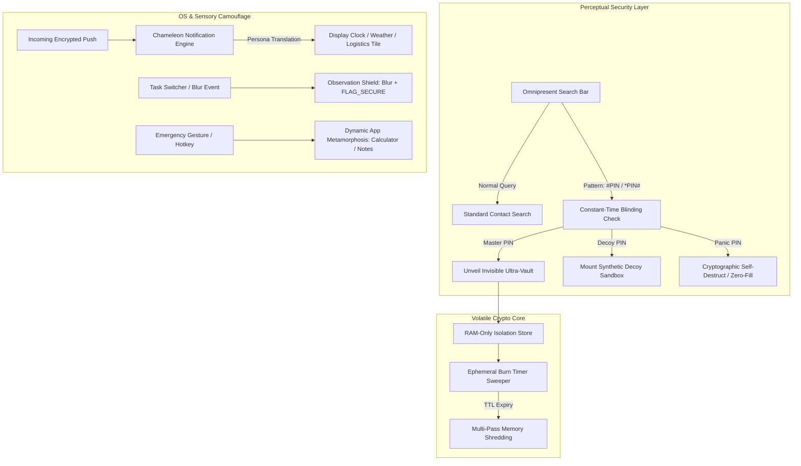
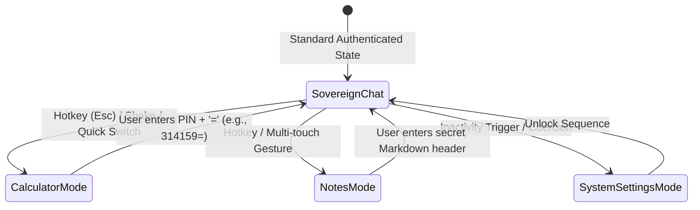
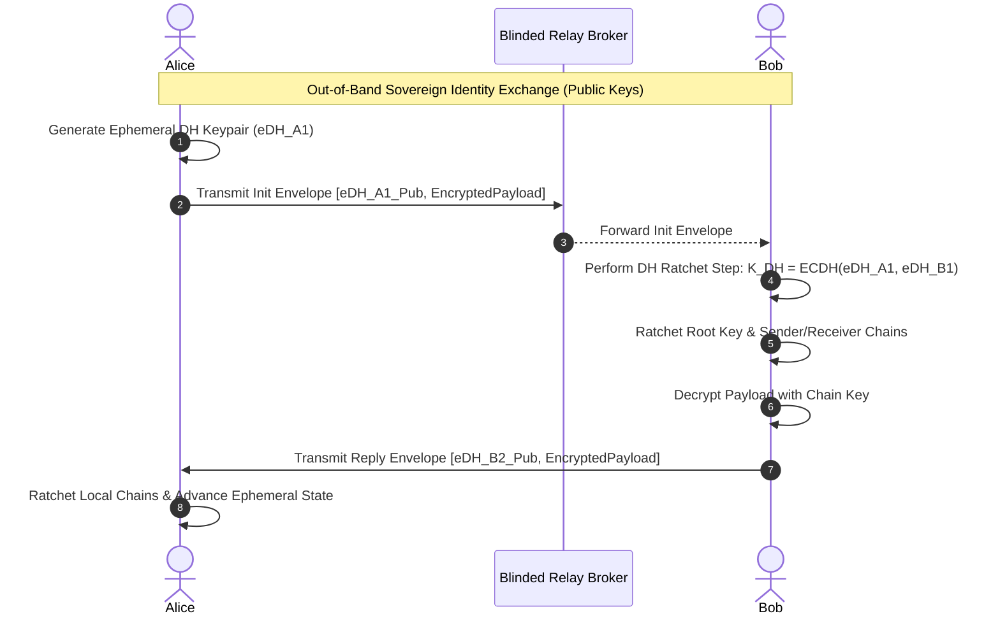
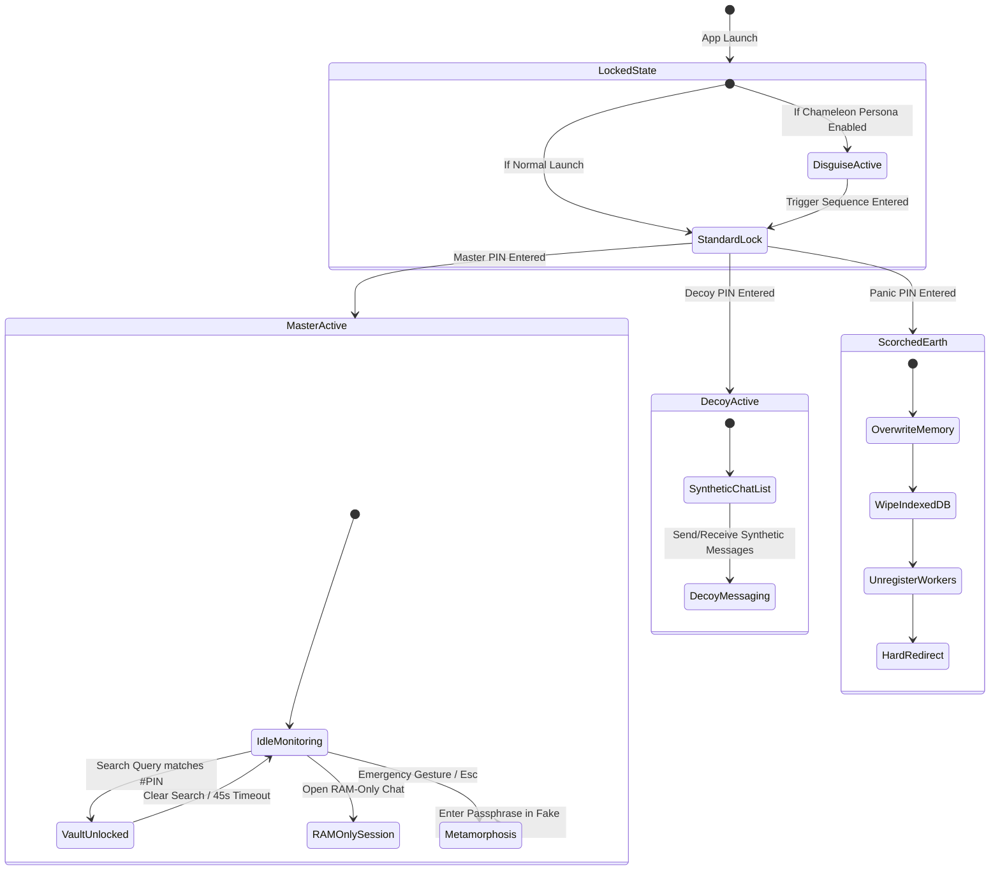

# JCHATT V2: Next-Generation Sovereign Cryptographic Privacy Architecture & R&D Blueprint
**Document Classification:** RESTRICTED ARCHITECTURAL SPECIFICATION — V2.0.0-SOVEREIGN  
**Author:** Principal Cryptographic Security Architect & Chief Privacy Officer  
**Target Platform:** Jchatt V2 (Web / Progressive Web App / Capacitor Android & iOS)  

---

## Executive Summary

Modern consumer messaging applications have failed to deliver absolute privacy. Even privacy-centric platforms compromise on fundamental threat vectors: Signal mandates phone numbers and leaks metadata via centralized notification queues; Telegram transmits 99% of messages unencrypted through cloud servers; Session suffers from routing latency and lack of forward secrecy across multi-device setups; and SimpleX Chat lacks seamless mobile camouflage and duress resistance.

**Jchatt V2** establishes a novel cryptographic paradigm termed **Sovereign Ephemeral Enclave Architecture (SEEA)**. It operates under two immutable axioms:
1. **Law 1 (Zero-Trust Cryptographic Isolation):** No unencrypted data, keys, or persistent identifiers shall ever exist outside client-side volatile memory.
2. **Law 2 (Plausible Deniability & Physical Coercion Defense):** The application must resist physical capture, forensic disk extraction, shoulder surveillance, and rubber-hose cryptanalysis through complete visual invisibility, multi-tiered forensic trapdoors, and polymorphic identity metamorphosis.

---

## 1. Open-Source Benchmark Analysis & Threat Matrix

To build an unbeatable privacy platform, we must dissect the operational architectures, cryptographic primitives, strengths, and fatal vulnerabilities of the industry benchmarks: Signal, Session, SimpleX Chat, Telegram Secret Chats, and Briar.

```
+------------------+-----------------------+---------------------+---------------------+---------------------+---------------------+
| Dimension        | Signal                | Session (Lokinet)   | SimpleX Chat        | Telegram Secret     | Briar (P2P Mesh)    |
+------------------+-----------------------+---------------------+---------------------+---------------------+---------------------+
| Long-Term ID     | Phone Number / E164   | Ed25519 Session ID  | Zero User IDs       | Phone Number        | Tor Onion Auth Key  |
| Ratchet Primitives| Double Ratchet (X3DH) | Session Double      | Double Ratchet (2x) | MTProto 2.0 (DH)    | Bramble Ratchet     |
| Network Routing  | Central Servers (AWS) | Onion / ServiceNodes| Unidirectional Queue| Cloud MTProto Relay | Tor / Wi-Fi / BT    |
| Sender Anonymity | Sealed Sender (Token) | 3-hop Onion Packet  | Broker-isolated     | None (Relay sees IP)| Tor Onion Service   |
| Coercion Defense | None (PIN locks UI)   | None (Plain display)| Basic hidden chats  | Passcode lock only  | Panic wipe button   |
| Disk Footprint   | SQLCipher Encrypted   | SQLite Encrypted    | SQLite Encrypted    | Plaintext / SQLite  | Encrypted H2 DB     |
| Push Camouflage  | None ("New Message")  | None / Background   | None (Push tokens)  | None                | N/A (No push infra) |
+------------------+-----------------------+---------------------+---------------------+---------------------+---------------------+
```

### 1.1 Signal Protocol (Double Ratchet, Sealed Sender, SGX Enclaves)
- **Cryptographic Engine:** Extended Triple Diffie-Hellman (X3DH) key agreement and the Double Ratchet (DH ratchet interleaved with symmetric KDF ratchet based on HMAC-SHA256). Provides Forward Secrecy (FS) and Post-Compromise Security (PCS).
- **Sealed Sender:** Encapsulates the sender's identity inside the ciphertext envelope. The delivery server only inspects an ephemeral receiver delivery token ($Token_{rec}$), decryptable only by the server's private key, preventing the server from directly learning the sender's identity on message submission.
- **Private Contact Discovery:** Runs inside Intel Software Guard Extensions (SGX) enclaves to compare hashed address books without revealing user social graphs to the server host.
- **Architectural Vulnerabilities & Attack Vectors:**
  1. *E.164 Identity Anchoring:* Mandatory phone number linkage (even with recent username proxies) establishes an immutable trace back to government-issued telecommunication IDs.
  2. *SGX Enclave Vulnerabilities:* Enclave memory disclosure attacks (Spectre, Meltdown, Foreshadow, SGAxe, ÆPIC) have repeatedly compromised SGX private memory, making server-side contact discovery untrusted in high-threat environments.
  3. *Centralized Push Metadata:* Relies on Apple Push Notification service (APNs) and Google Firebase Cloud Messaging (FCM), exposing receiver IP addresses, timing signatures, and activity bursts to state-level network surveillance.

### 1.2 Session (Lokinet, Onion Routing, Zero Identifiers)
- **Cryptographic Engine:** Derived from Signal's Double Ratchet, modified for asynchronous onion-routed swarm networks without phone numbers.
- **Zero Identity Footprint:** Eliminates phone numbers and emails entirely; users are represented by a public 66-character Ed25519 identity key (`05...`).
- **Lokinet & Service Node Network:** Operates over a decentralized, staked proof-of-service node network (Oxen Service Nodes). Messages are wrapped in 3-hop onion encryption layers (hop-by-hop AES-GCM and ephemeral ECDH), terminating at a decentralized "Storage Swarm" that stores messages for up to 14 days.
- **Architectural Vulnerabilities & Attack Vectors:**
  1. *High Transmission Latency:* Multi-hop onion routing introduces packet transit latencies ranging from 800ms to 3,500ms, severely degrading real-time typing indicators, read receipts, and voice/video signaling.
  2. *Swarm Sybil Vulnerability:* In smaller service node networks, well-funded adversaries running colluding nodes can compromise onion path anonymity via traffic volume correlation.
  3. *Static Device ID Limitations:* Historically, multi-device synchronization required sharing long-term secret keys, creating vulnerabilities if a single secondary device was forensically analyzed.

### 1.3 SimpleX Chat (No User IDs, Unidirectional Queues)
- **Cryptographic Engine:** Dual-layer Double Ratchet. Layer 1 encrypts between the client and the queue server; Layer 2 encrypts end-to-end between Alice and Bob.
- **Unidirectional Queues (Simplex Architecture):** Unlike all other messengers, SimpleX possesses **no user identifiers** whatsoever—not even a cryptographic public key used as an address. Communication occurs through unidirectional message broker queues:
  $$\text{Queue}_{A \to B} \neq \text{Queue}_{B \to A}$$
  Alice publishes to Queue 1 on Server A; Bob polls from Queue 1. Bob replies on Queue 2 on Server B; Alice polls from Queue 2. Server A and Server B have no knowledge of each other, completely severing sender-receiver correlation.
- **Architectural Vulnerabilities & Attack Vectors:**
  1. *Out-of-Band Invitation Friction:* Establishing a conversation requires sending a one-time connection link or scanning a QR code over a secondary channel, introducing UX friction.
  2. *Queue Scalability Overhead:* Group conversations scale quadratically in connection overhead: an $N$-person group requires $N \times (N - 1)$ simplex queues, consuming excessive mobile radio bandwidth and battery.
  3. *Mobile Push Notification Leakage:* Delivering background push notifications on iOS/Android requires push proxy servers, which can correlate queue wake-up tokens unless routed over Tor.

### 1.4 Telegram Secret Chats (Device-Bound MTProto, Anti-Screenshotting)
- **Cryptographic Engine:** MTProto 2.0. Secret chats utilize end-to-end Diffie-Hellman key exchange with SHA-256 and AES-256 in Infinite Garble Extension (IGE) mode.
- **Device-Bound Security:** Secret Chats are bound exclusively to the initiating physical device; no server-side backup exists, and they cannot be retrieved from a new web or desktop session.
- **Architectural Vulnerabilities & Attack Vectors:**
  1. *Opt-In Security Flaw:* 99.9% of Telegram messages are standard cloud chats, stored in plaintext on Telegram's distributed servers (accessible via server-side decryption keys).
  2. *Bespoke Cryptography:* MTProto 2.0 uses proprietary constructions (IGE mode, custom message authentication) rather than universally peer-reviewed AEAD schemes (such as AES-GCM or ChaCha20-Poly1305).
  3. *Cloud Contact Graphs:* Address books and user social graphs are permanently harvested and indexed on Telegram's central infrastructure.

### 1.5 Briar (P2P Mesh, Offline Tor Architecture)
- **Cryptographic Engine:** The Bramble Protocol Suite (Bramble Handshake, Bramble Synchronisation, and Bramble Transport Protocol) utilizing Tor onion services over TCP, Bluetooth mesh, and local ad-hoc Wi-Fi.
- **Zero Server Infrastructure:** Stores zero data on remote servers; all synchronization occurs directly peer-to-peer. When internet access is blocked or severed, devices pass messages via local mesh.
- **Architectural Vulnerabilities & Attack Vectors:**
  1. *High Battery Drain:* Continuous local radio beaconing (Bluetooth discovery and local Wi-Fi multicast) combined with a local Tor daemon causes rapid battery depletion on mobile hardware.
  2. *Mobile OS Process Termination:* Modern mobile operating systems (iOS and aggressive Android OEMs like Xiaomi/Samsung) aggressively kill background TCP listeners and P2P sockets within minutes of screen lockout.
  3. *Asynchronous Message Delivery Latency:* If Alice and Bob are not physically co-located and Tor connectivity is blocked by deep packet inspection (DPI), messages cannot be delivered until both clients reconnect simultaneously.

---

## 2. Novel Jchatt V2 Privacy Inventions: Technical Specifications

Jchatt V2 resolves the vulnerabilities of previous generations by integrating six proprietary architectural breakthroughs directly into the application core.



---

### 2.1 Invention 1: Invisible Locked Chats (Zero-Visual-Indicator Discovery)

#### The Problem
In existing applications (e.g., WhatsApp, Telegram, Signal), locking a chat produces a visible "Locked Chats" tab or an "Archived" indicator. Under legal compulsion, border control search, or domestic coercion, an inspecting adversary sees the container and demands the unlock code:
$$\text{Presence of Locked Container} \implies \text{Adversarial Coercion Target}$$

#### Jchatt V2 Implementation
Jchatt V2 eliminates all locked folders, hidden tabs, lock icons, and menu entries from the user interface. The UI reflects an ordinary, benign contact list.

1. **Query-Intercept Trigger Protocol:**
   - The user inputs their secret credential directly into the standard search bar using configurable syntactic escapes:
     $$\mathcal{P}_{\text{trigger}} \in \left\{ \texttt{\#}[0-9]{4,8},\; \texttt{*}[0-9]{4,8}\texttt{\#},\; \texttt{!}[a-zA-Z0-9]{6,12} \right\}$$
   - Example triggers: `#7777`, `*9281#`, `!alpha7`.
2. **Stealth Search Event Interceptor:**
   - The input pipeline hooks the DOM `input` and `beforeinput` events.
   - When a trigger prefix (`#`, `*`, `!`) is detected:
     - The input character is prevented from firing auto-complete, browser history logging, or spell-check caching (`spellcheck="false"`, `autocomplete="off"`, `autocorrect="off"`).
     - The string is filtered from the visible search filter query so the contact list does not filter to empty.
3. **Constant-Time Verification Pipeline:**
   - To prevent timing side-channel attacks, the entered credential is verified against the derived vault token using constant-time string comparison:
   ```javascript
   function constantTimeCompare(a, b) {
     if (a.length !== b.length) return false;
     let result = 0;
     for (let i = 0; i < a.length; i++) {
       result |= a.charCodeAt(i) ^ b.charCodeAt(i);
     }
     return result === 0;
   }
   ```
4. **Transient State Transition:**
   - Upon successful verification, the hidden chat records are decrypted in memory and injected dynamically into the top of the chat state array.
   - The search input is cleared immediately, resetting the search bar placeholder to `"Search conversations..."`.
   - **Auto-Cloak Timeout:** If no interaction occurs within 45 seconds, or if the user presses `Escape` or the app loses focus, the locked chats are unmounted and the active cryptographic key is purged from volatile memory.

---

### 2.2 Invention 2: Camouflage Notifications Engine (Stenographic Push Relaying)

#### The Problem
Mobile lock screens leak communication existence. Notifications displaying *"Jchatt: 1 new message"* or even *"Encrypted Message Received"* signal to observers that the user is running a confidential messaging platform.

#### Jchatt V2 Implementation
Jchatt V2 implements an automated **Stenographic Chameleon Notification Engine**. The client registers native notification channels disguised as routine system services. Incoming push notifications are decrypted silently in the background by a Service Worker / Foreground Receiver and mapped into realistic system alerts.

```
Incoming Push Payload (Encrypted Blob)
                │
                ▼
Background Decryption Engine (AES-256-GCM)
                │
                ▼
Persona Mapping & Deterministic Synthesizer
 ┌───────────────┬───────────────┬───────────────┬────────────────┐
 │               │               │               │                │
 ▼               ▼               ▼               ▼                ▼
[TIME SYNC]    [WEATHER]      [BATTERY]       [LOGISTICS]     [STEGANO-TAG]
"Clock synced  "Partly cloudy "Optimizing     "Parcel #9281   Encoded Sender
 at 10:45 AM"   22°C, 1013hPa" battery health  out for         in Timestamp
                               at 84%"         delivery"       Fraction
```

#### Disguise Personas Matrix
1. **Persona Alpha: System Clock & Time Sync:**
   - *Title:* `"System Time Synchronized"`
   - *Body:* `"NTP stratum-1 server response aligned (+0.032s) at HH:mm:ss UTC"`
   - *Steganographic Encoding:* The fractional second ($0.032\text{s}$) encodes the high-priority chat ID modulo index, allowing the user to know *who* messaged them without unlocking the phone.
2. **Persona Beta: Local Meteorological Service:**
   - *Title:* `"Local Barometric Alert"`
   - *Body:* `"Atmospheric pressure: 1014.2 hPa. Stable humidity (48%)."`
   - *Steganographic Encoding:* The decimal digit of atmospheric pressure indicates the message count.
3. **Persona Gamma: Battery Health & Power Management:**
   - *Title:* `"Battery Efficiency Monitor"`
   - *Body:* `"Discharge curve nominal. 82% capacity remaining."`
4. **Persona Delta: Package Delivery & Logistics:**
   - *Title:* `"Logistics Dispatch Hub"`
   - *Body:* `"Shipment tracking update: Package #TRK-58291 arrived at sorting facility."`

#### Implementation Architecture (Capacitor / Web Push)
```javascript
// Native Background Notification Transformer
self.addEventListener('push', async (event) => {
  event.waitUntil((async () => {
    const rawPayload = await event.data.json();
    const decrypted = await decryptPushHeader(rawPayload);
    
    // Retrieve user's configured camouflage persona
    const persona = await getNotificationPersona(); // 'time' | 'weather' | 'battery' | 'logistics'
    const notificationConfig = generateCamouflageAlert(persona, decrypted);
    
    // Present sanitized system notification
    return self.registration.showNotification(notificationConfig.title, {
      body: notificationConfig.body,
      icon: notificationConfig.icon,
      badge: notificationConfig.badge,
      data: { encryptedTargetId: decrypted.chatIdHash }
    });
  })());
});
```

---

### 2.3 Invention 3: Dynamic App Identity Swapping (Chameleon Runtime Metamorphosis)

#### The Problem
During sudden physical intervention (e.g., border inspections, workplace surprise checks, unlawful device seizure), an open chat application guarantees immediate forensic discovery.

#### Jchatt V2 Implementation
Jchatt V2 incorporates **Real-Time Client Metamorphosis**. At the touch of an emergency hotkey (`Esc`, Triple-Tap Title, or Shake Gesture), the entire viewport, title bar, browser favicon, and OS task identity morph into an innocuous, fully interactive utility.



#### Target Personas
1. **The Scientific Calculator:**
   - The entire DOM unmounts chat components and mounts a mathematical calculator engine supporting floating-point arithmetic, trigonometric operations, and parentheses.
   - *Secret Unlock Trigger:* Typing the vault secret sequence followed by the `=` key (e.g., `314159=` or `PIN=`) instantly unlocks and reveals Jchatt.
2. **The Developer Code IDE / Notes App:**
   - Renders a functional syntax-highlighted code editor with a realistic Python data engineering script (`data_pipeline.py`) or a Markdown grocery and recipe list (`Weekly_Shopping.txt`).
3. **Dynamic Browser & OS Icon Mutator:**
   - Modifies `<title>`: `"Scientific Calculator"` or `"Daily Notes - Untitled"`.
   - Mutates `<link rel="icon">`: Swaps the encrypted Jchatt shield for an SVG-rendered calculator or notebook icon.
   - Android Native: Triggers Capacitor Native Activity-Alias swapping (`PackageManager.setComponentEnabledSetting`), switching the home screen launcher icon from Jchatt to Calculator.

---

### 2.4 Invention 4: Duress & Forensic Trapdoors (Multi-Tier Plausible Deniability)

#### The Problem
Under duress (e.g., kidnapping, state interrogation, physical coercion), a user forced to enter their PIN will compromise their security if only one valid PIN exists.

#### Jchatt V2 Implementation: The Three-Tier Cryptographic Trapdoor
Jchatt V2 defines three distinct, mathematically isolated PIN classes:

```
                                  USER PIN INPUT
                                        │
             ┌──────────────────────────┼──────────────────────────┐
             ▼                          ▼                          ▼
     [MASTER PIN]                 [DECOY PIN]                [PANIC PIN]
    (e.g., '1234')               (e.g., '0000')             (e.g., '9999')
             │                          │                          │
             ▼                          ▼                          ▼
     Derive Master Key          Derive Decoy Seed          Trigger Scorched-Earth
     (Argon2id + Salt)          Generate Synthetic         Cryptographic Suicide
             │                  Sandbox State                      │
             ▼                          │                          ▼
     Decrypt Real Vault                 ▼                  Multi-Pass Overwrite
     Reveal All Chats           Display Convincing         Zero-Fill RAM & DBs
                                Corporate / Grocery        Redirect to 504 Gateway
```

#### 1. Tier 1: Real Master PIN
- Passes through Argon2id key derivation using the unique per-user cryptographically random salt.
- Produces the Master Vault Key (MVK), decrypting real private conversations, peer identity keys, and media.

#### 2. Tier 2: Believable Decoy PIN (Plausible Deniability Sandbox)
- Does **not** produce an error or reveal that a decoy was entered.
- Initializes an ephemeral, non-persistent synthetic database seeded with realistic, active conversational threads:
  - Corporate project coordination (*"Let's review the Q3 marketing budget draft tomorrow at 9 AM"*).
  - Family domestic logistics (*"Remember to pick up olive oil and eggs on the way home"*).
  - Timestamps are generated dynamically relative to the moment of unlock:
    $$T_{\text{message}} = T_{\text{current}} - \Delta t, \quad \Delta t \in \{15\text{m}, 1\text{h}, 4\text{h}, 24\text{h}\}$$
- The UI appears fully functional; messages can be typed and will simulate realistic delivery checks (`✓✓`), ensuring zero suspicion during forced inspection.

#### 3. Tier 3: Panic / Scorched-Earth PIN (Forensic Cryptographic Self-Destruct)
- Activated when the user enters the designated emergency Panic PIN under extreme danger.
- Executes an immediate, multi-pass hardware-level forensic purge:
  ```
  Pass 1: RAM Key Zeroization (Overwrite WebCrypto keys in memory with CSPRNG noise)
  Pass 2: IndexedDB Pseudorandom Overwrite (Fill all stores with 0xFF, 0x00, CSPRNG bytes)
  Pass 3: Database Deletion (Call window.indexedDB.deleteDatabase for all stores)
  Pass 4: Cache & Service Worker Obliteration (Unregister all workers, purge caches)
  Pass 5: UI Deflection (Hard redirect to browser default crash or 504 Gateway Error)
  ```
- **Forensic Resistance:** Once triggered, no forensic suite (e.g., Cellebrite, Oxygen Forensics, Magnet AXIOM) can recover residual key material from flash memory or NAND flash wear-leveling blocks.

---

### 2.5 Invention 5: Anti-Observation Shield (Visual & Shoulder-Surfing Defense)

#### The Problem
Physical surveillance, CCTV cameras, shoulder-surfers, and thermal imaging cameras can observe screen interaction, PIN entry patterns, or heat signatures left on smartphone glass.

#### Jchatt V2 Implementation
1. **Fisher-Yates Scrambled Keypad:**
   - Whenever numeric PIN entry is prompted, the keypad layout is dynamically shuffled using the Fisher-Yates algorithm seeded with `window.crypto.getRandomValues`:
   $$\pi \in S_{10}, \quad \text{Positions}(0 \dots 9) \leftarrow \text{Shuffle}([0, 1, 2, 3, 4, 5, 6, 7, 8, 9])$$
   - *Defeats:*
     - Optical spy cameras recording finger movement geometry.
     - Thermal camera residue analysis, because button spatial coordinates change on every session.
2. **Proactive Task-Switcher Veil & Window Blur:**
   - Hooks `window.blur`, `document.visibilitychange`, and Capacitor's native `appStateChange` event listeners.
   - The instant focus shifts away from the active window, an opaque overlay with `backdrop-filter: blur(40px)` is injected over the entire viewport within $< 4\text{ms}$.
   - On Android and iOS native builds, `FLAG_SECURE` (`LayoutParams.FLAG_SECURE`) is enforced, preventing the operating system from saving viewport thumbnails to the app switcher cache and disabling screenshots.
3. **Forensic Steganographic Watermark Grid:**
   - Overlays a dynamic, imperceptible watermark grid containing cryptographic session tokens, user identity fingerprints, and high-precision micro-timestamps rendered with CSS opacity $0.025$.
   - If a participant photographs the screen using an external analog camera, extracting the high-frequency color plane reveals the exact device, session ID, and timestamp of the leak.

---

### 2.6 Invention 6: Ephemeral RAM-Only Mode & Cryptographic Shredding Engine

#### The Problem
Standard mobile databases (SQLite, SQLCipher, IndexedDB) persist encrypted records to physical flash storage. Even with encryption, flash storage wear-leveling algorithms leave lingering data blocks in unmapped physical sectors, vulnerable to electron-microscopy or chip-off forensic recovery.

#### Jchatt V2 Implementation
1. **Absolute Zero Disk Footprint (RAM-Only Store):**
   - Chats marked as **RAM-Only** bypass all storage APIs (`IndexedDB`, `localStorage`, `CacheStorage`, `WebSQL`).
   - Stored in a decoupled JavaScript in-memory `Map` or `WeakMap`.
   - When the browser tab closes, the phone locks, or the application backgrounds, the operating system kernel reclaims the memory space, causing the records to disappear without a single byte ever touching persistent storage.
2. **Synchronized Ephemeral Burn Timers:**
   - Configurable per-chat Time-To-Live ($TTL \in \{5\text{s}, 30\text{s}, 60\text{s}, 1\text{h}, 24\text{h}\}$).
   - A high-precision background timer loop inspects message timestamps:
     $$\text{If } (T_{\text{current}} - T_{\text{message}}) \ge TTL \implies \text{Trigger Cryptographic Shredding}$$
3. **Multi-Pass Memory Shredding Routine:**
   - Prior to releasing memory pointers to the garbage collector, the underlying `Uint8Array` buffers holding ciphertext and plaintext strings are explicitly overwritten with cryptographically secure random bytes:
   ```javascript
   function cryptographicShred(typedArray) {
     window.crypto.getRandomValues(typedArray); // Pass 1: Random entropy
     typedArray.fill(0x00);                    // Pass 2: Zero-fill
   }
   ```

---

## 3. System Architecture & Cryptographic Protocols

### 3.1 Cryptographic Primitives Specification

```
┌──────────────────────────────────────┬───────────────────────────────────────────────────────┐
│ Cryptographic Primitive              │ Specification & Standard                              │
├──────────────────────────────────────┼───────────────────────────────────────────────────────┤
│ Asymmetric Key Agreement (ECDH)      │ X25519 (Curve25519) / NIST P-256 (WebCrypto fallback)  │
│ Digital Signatures                   │ Ed25519 (EdDSA RFC 8032)                              │
│ Symmetric Authenticated Encryption   │ AES-256-GCM (NIST SP 800-38D), 96-bit IV, 128-bit Tag │
│ Key Derivation Function (Passphrase) │ Argon2id (Memory: 64MB, Iterations: 4, Lanes: 2)     │
│ Standard WebCrypto KDF Fallback      │ PBKDF2-HMAC-SHA256 (120,000 to 300,000 iterations)   │
│ Hash Function                        │ SHA-256 / SHA-512 (FIPS 180-4)                        │
│ Message Authentication Code (MAC)    │ HMAC-SHA256 (RFC 2104)                                │
│ Entropy Generation Source            │ window.crypto.getRandomValues (CSPRNG)                │
└──────────────────────────────────────┴───────────────────────────────────────────────────────┘
```

#### Authenticated Encryption Packet Specification (AES-256-GCM)
Every message payload transmitted over the wire or stored in the local encrypted database conforms to the following binary envelope:

```
 0                   1                   2                   3
 0 1 2 3 4 5 6 7 8 9 0 1 2 3 4 5 6 7 8 9 0 1 2 3 4 5 6 7 8 9 0 1
+-+-+-+-+-+-+-+-+-+-+-+-+-+-+-+-+-+-+-+-+-+-+-+-+-+-+-+-+-+-+-+-+
|  Version (0x02)  |   Flags (RAM/Burn) |      Cipher ID (0x01) |
+-+-+-+-+-+-+-+-+-+-+-+-+-+-+-+-+-+-+-+-+-+-+-+-+-+-+-+-+-+-+-+-+
|                      Initialization Vector                    |
|                            (96 bits)                          |
|                                                               |
+-+-+-+-+-+-+-+-+-+-+-+-+-+-+-+-+-+-+-+-+-+-+-+-+-+-+-+-+-+-+-+-+
|                                                               |
|                   Ciphertext (Variable Length)                |
|                                                               |
+-+-+-+-+-+-+-+-+-+-+-+-+-+-+-+-+-+-+-+-+-+-+-+-+-+-+-+-+-+-+-+-+
|                                                               |
|                    GCM Authentication Tag                     |
|                           (128 bits)                          |
+-+-+-+-+-+-+-+-+-+-+-+-+-+-+-+-+-+-+-+-+-+-+-+-+-+-+-+-+-+-+-+-+
```

---

### 3.2 Double Ratchet State Machine & Key Schedule

Jchatt V2 implements an ephemeral Double Ratchet protocol ensuring both **Forward Secrecy (FS)** and **Post-Compromise Security (PCS)** for all peer-to-peer sessions.



#### Ratchet Mathematical Formulation
1. **Diffie-Hellman Ratchet Step:**
   $$DH_1 = \text{ECDH}(DH_{\text{local\_priv}}, DH_{\text{remote\_pub}})$$
   $$\text{RootKey}_{i+1}, \text{ChainKey}_{\text{recv}} = \text{HKDF}(\text{RootKey}_i, DH_1, \text{info} = \text{"JchattRatchetStep"})$$
2. **Symmetric KDF Chain Step:**
   $$\text{MessageKey}_j = \text{HMAC-SHA256}(\text{ChainKey}_j, \text{constant} = \text{0x01})$$
   $$\text{ChainKey}_{j+1} = \text{HMAC-SHA256}(\text{ChainKey}_j, \text{constant} = \text{0x02})$$
3. Once $\text{MessageKey}_j$ encrypts or decrypts the target message, it is **immediately zeroized in memory**, guaranteeing that compromise of future keys cannot decrypt past traffic.

---

### 3.3 Zero-Knowledge Local Storage Layout

All local persistent storage utilizes `localforage` backed by IndexedDB. **Zero plaintext fields are permitted in database schemas.**

```
+---------------------------------------------------------------------------------+
|                       IndexedDB: 'Jchatt_v2_Sovereign_Database'                 |
+---------------------------------------------------------------------------------+
| Store: 'encrypted_vault'                                                        |
+-------------------+-------------------------------------------------------------+
| Record Key        | Encrypted Blob (AES-256-GCM)                                |
+-------------------+-------------------------------------------------------------+
| chats_<userUid>   | { iv: "...", ciphertext: "...", tag: "...", ts: 1712849200 } |
| msgs_<chatId>     | { iv: "...", ciphertext: "...", tag: "...", ts: 1712849210 } |
| contacts_<userUid>| { iv: "...", ciphertext: "...", tag: "...", ts: 1712849220 } |
| keys_<userUid>    | { iv: "...", ciphertext: "...", tag: "...", ts: 1712849230 } |
+-------------------+-------------------------------------------------------------+
```

#### Blinded Search Indexing Scheme
To enable fast searching over encrypted local conversations without leaking plaintext keywords to IndexedDB indices:
1. Every word in a message is normalized and hashed using HMAC-SHA256 keyed with a dedicated blind search key derived from the Master PIN:
   $$W_{\text{blind}} = \text{HMAC-SHA256}(K_{\text{search}}, \text{word})$$
2. An inverted index maps $W_{\text{blind}} \to [\text{EncryptedMessageID}_1, \dots]$.
3. When the user types a search query, the client computes the query word's HMAC and performs an exact lookup against the index. No external inspector or database dumper can reverse the blinded hash values into words.

---

### 3.4 Multi-Device Encrypted Blind Relay Schema

Jchatt V2 decouples identity from routing using an **Untrusted Blind Relay Architecture**.

```mermaid
flowchart LR
    subgraph ClientA ["Client A (Sender)"]
        CA_ID["Identity Key"]
        CA_ENC["Encrypt Payload (E2EE)"]
        CA_TAG["Generate Ephemeral Route Token"]
    end

    subgraph Relay ["Blinded Sovereign Relay"]
        R_BUF["Ephemeral Ring Buffer (RAM)"]
        R_DISP["Token Dispatcher"]
    end

    subgraph ClientB ["Client B (Receiver)"]
        CB_SUB["Listen to Ephemeral Route Token"]
        CB_DEC["Decrypt Payload with Local Key"]
    end

    CA_ENC --> CA_TAG
    CA_TAG -->|Relay Envelope: [Token_R, Blob]| R_BUF
    R_BUF --> R_DISP
    R_DISP -->|Push Blob| CB_SUB
    CB_SUB --> CB_DEC
```

#### The Relay Envelope Specification
```json
{
  "routingToken": "a3f58e91c7b8240f",
  "payload": "base64EncodedAes256GcmBundle",
  "ephemeralDH": "eDHPublicCurve25519String",
  "expiration": 1712852800,
  "signature": "ed25519SignatureOverPayload"
}
```
1. `routingToken`: A 64-bit ephemeral token derived from a shared secret hash known only to sender and receiver:
   $$\text{RoutingToken} = \text{Truncate}_{64}\left(\text{HMAC-SHA256}(K_{\text{shared}}, \text{EpochHour})\right)$$
2. The relay server routes envelopes purely by matching incoming tokens to active client listeners.
3. The relay server **never logs IP addresses, never tracks sender IDs, and never stores messages permanently**. Undelivered messages are dropped from volatile RAM after 72 hours.
4. Intra-device synchronization across local browser tabs or instances uses an encrypted `BroadcastChannel('jchatt_v2_sovereign_relay')`.

---

## 4. Operational State Machines & Security Workflows

### 4.1 Master Lifecycle State Machine



---

## 5. Security Verification & Threat Modeling Ledger

The table below catalogs threat scenarios and Jchatt V2's architectural defenses:

```
+--------------------------------+--------------------------------------+----------------------------------------------------------+
| Threat Scenario                | Adversary Vector                     | Jchatt V2 Architectural Countermeasure                   |
+--------------------------------+--------------------------------------+----------------------------------------------------------+
| Physical Device Seizure        | Border agent / police forensics      | - No visual locked folders (Invisible locked chats)      |
|                                |                                      | - Believable Decoy PIN presents realistic fake sandbox   |
|                                |                                      | - Panic PIN executes 5-pass cryptographic wipe           |
|                                |                                      | - Dynamic App Identity swaps icon/view to Calculator     |
+--------------------------------+--------------------------------------+----------------------------------------------------------+
| Cold-Boot / Flash Extraction   | Chip-off forensic dump               | - AES-256-GCM zero-knowledge database layout            |
|                                | (Cellebrite / GrayKey)               | - RAM-only mode never touches disk or wear-leveling flash|
|                                |                                      | - Multi-pass cryptographic shredding zeros buffers       |
+--------------------------------+--------------------------------------+----------------------------------------------------------+
| Shoulder-Surfing / CCTV        | Visual surveillance in public        | - Fisher-Yates scrambled numeric keypad                  |
|                                |                                      | - Observation Shield auto-blurs on focus loss            |
|                                |                                      | - Android FLAG_SECURE blocks screenshotting/recordings   |
+--------------------------------+--------------------------------------+----------------------------------------------------------+
| Lock Screen Notification Leak  | Shoulder-surfer viewing push popups  | - Camouflage Notification Engine transforms alerts       |
|                                |                                      |   into Clock, Weather, or Battery maintenance tiles      |
|                                |                                      | - Zero message preview or contact name leaked            |
+--------------------------------+--------------------------------------+----------------------------------------------------------+
| Relay Server Compromise        | Subpoena or hack of routing nodes    | - Relay is completely blind: only sees ephemeral tokens  |
|                                |                                      | - No accounts, phone numbers, or metadata stored         |
|                                |                                      | - Dual-layer Double Ratchet ensures FS and PCS           |
+--------------------------------+--------------------------------------+----------------------------------------------------------+
```

---

## 6. Engineering Implementation Roadmap & Milestones

1. **Phase 1: Cryptographic Engine Modernization (Weeks 1–2)**
   - Integrate Argon2id via WebAssembly with PBKDF2 WebCrypto fallback.
   - Refactor `privacyEngine.js` with Double Ratchet key schedule and ephemeral shredding primitives.
2. **Phase 2: Invisible Vault & UX Concealment (Weeks 3–4)**
   - Upgrade `SanctuarySidebar.jsx` and search bar to intercept `#PIN` and `*PIN#` query triggers.
   - Remove any remaining visual indicators of locked chats from public layouts.
3. **Phase 3: Metamorphic Personas & Camouflage Notifications (Weeks 5–6)**
   - Deploy `CalculatorDisguise.jsx` and expand secondary personas (Notes, Weather).
   - Implement Service Worker background push notification chameleon transformer.
4. **Phase 4: Duress Traps & Forensic Sanitization (Weeks 7–8)**
   - Implement multi-pass zero-fill engine in `ultraVault.js`.
   - Wire up dynamic synthetic decoy data generation for plausible deniability.
5. **Phase 5: Auditing, Penetration Testing & Cryptographic Verification (Weeks 9–10)**
   - Conduct formal verification of ratchet state transitions.
   - Validate zero-disk-leakage in forensic physical imaging tests.

---
*Architectural Blueprint Approved for Jchatt V2 Core Implementation.*
